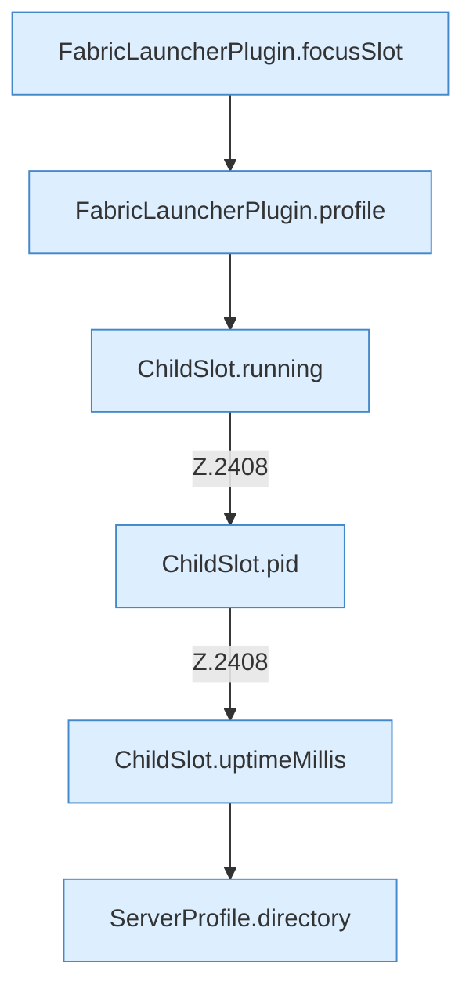

[[00 Start]] › [[Plugin-Kern]] › [[Befehle]] › [[FabricLauncherPlugin.onCommand]] › [[FabricLauncherPlugin.onCommand.Z2401.Case2405]]

# FabricLauncherPlugin.onCommand.Z2401.Case2405



```knoten
FabricLauncherPlugin.focusSlot
  Liefert oder setzt den Fokus `focusSlot`. Ruft `slot`.
FabricLauncherPlugin.profile
  `profile` in `FabricLauncherPlugin.java`.
ChildSlot.running
  Sagt, ob der Prozess läuft `running`.
ChildSlot.pid
  Liefert die Prozessnummer `pid`.
ChildSlot.uptimeMillis
  Liefert die Laufzeit `uptimeMillis`. Ruft `running`.
ServerProfile.directory
  `directory` in `ServerProfile.java`.
```

- Fortsetzung von `FabricLauncherPlugin.onCommand.Z2401`, Quellreihenfolge.
