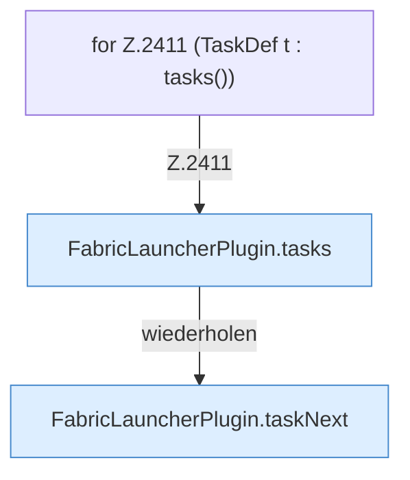

[[00 Start]] › [[Plugin-Kern]] › [[Befehle]] › [[FabricLauncherPlugin.onCommand]] › [[FabricLauncherPlugin.onCommand.Z2401.Case2411]]

# FabricLauncherPlugin.onCommand.Z2401.Case2411



```knoten
for Z.2411 (TaskDef t : tasks())
  Zeile 2411: Schleife `(TaskDef t : tasks())`.
FabricLauncherPlugin.tasks
  Das [[Glossar#Plugin|Plugin]] macht hier einen einzelnen Schritt. Eine Ebene tiefer steht er genauer. `tasks` in `FabricLauncherPlugin.java`. Ruft `load`.
FabricLauncherPlugin.taskNext
  Rechnet, wann eine [[Glossar#Aufgabe|Aufgabe]] das nächste Mal laufen soll. `taskNext` in `FabricLauncherPlugin.java`. Ruft `next`.
```

> [!knoten]- Was die Blöcke tun
> - **for Z.2411 (TaskDef t : tasks())**: Zeile 2411: Schleife `(TaskDef t : tasks())`.
> - **FabricLauncherPlugin.tasks**: Das [[Glossar#Plugin|Plugin]] macht hier einen einzelnen Schritt. Eine Ebene tiefer steht er genauer. `tasks` in `FabricLauncherPlugin.java`. Ruft `load`.
> - **FabricLauncherPlugin.taskNext**: Rechnet, wann eine [[Glossar#Aufgabe|Aufgabe]] das nächste Mal laufen soll. `taskNext` in `FabricLauncherPlugin.java`. Ruft `next`.

- Das Innere eines Wegs, ab [[Glossar#Zeile|Zeile]] 2411.
- Fortsetzung von `FabricLauncherPlugin.onCommand.Z2401`.
