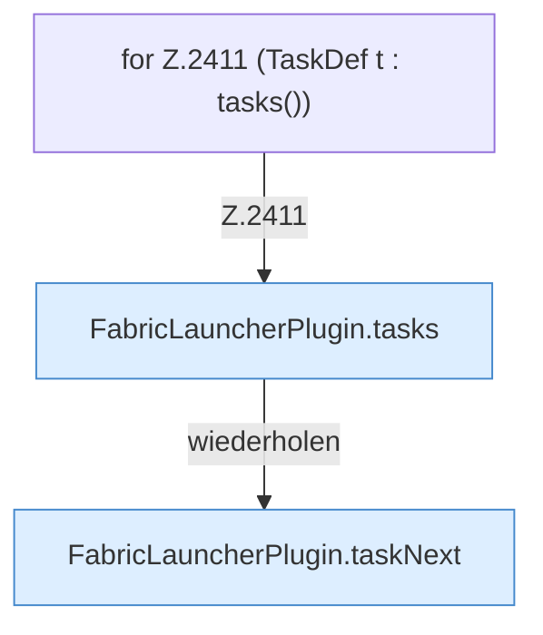

[[00 Start]] › [[Plugin-Kern]] › [[Befehle]] › [[FabricLauncherPlugin.onCommand]] › [[FabricLauncherPlugin.onCommand.Z2401.Case2411]]

# FabricLauncherPlugin.onCommand.Z2401.Case2411



```knoten
for Z.2411 (TaskDef t : tasks())
  Zeile 2411: Schleife `(TaskDef t : tasks())`.
FabricLauncherPlugin.tasks
  `tasks` in `FabricLauncherPlugin.java`. Ruft `load`.
FabricLauncherPlugin.taskNext
  `taskNext` in `FabricLauncherPlugin.java`. Ruft `next`.
```

- Fortsetzung von `FabricLauncherPlugin.onCommand.Z2401`, Quellreihenfolge.
