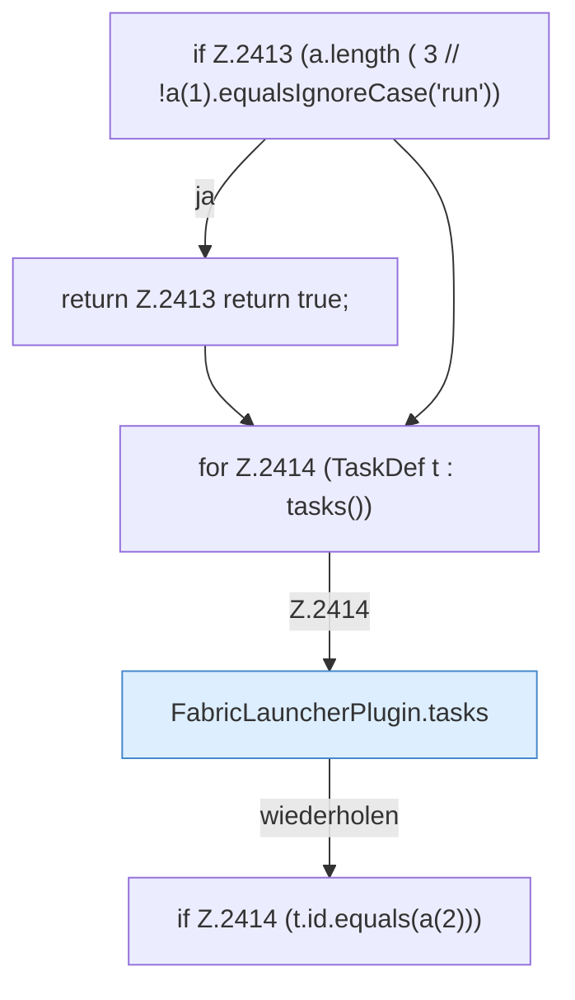

[[00 Start]] › [[Plugin-Kern]] › [[Befehle]] › [[FabricLauncherPlugin.onCommand]] › [[FabricLauncherPlugin.onCommand.Z2401.Case2412.Teil1]]

# FabricLauncherPlugin.onCommand.Z2401.Case2412.Teil1



```knoten
if Z.2413 (a.length ( 3 // !a(1).equalsIgnoreCase('run'))
  Zeile 2413: prüft `(a.length ( 3 // !a(1).equalsIgnoreCase('run'))`.
return Z.2413 return true;
  Zeile 2413: Rückgabe `return true;`.
for Z.2414 (TaskDef t : tasks())
  Zeile 2414: Schleife `(TaskDef t : tasks())`.
FabricLauncherPlugin.tasks
  Das [[Glossar#Plugin|Plugin]] macht hier einen einzelnen Schritt. Eine Ebene tiefer steht er genauer. `tasks` in `FabricLauncherPlugin.java`. Ruft `load`.
if Z.2414 (t.id.equals(a(2)))
  Zeile 2414: prüft `(t.id.equals(a(2)))`.
```

> [!knoten]- Was die Blöcke tun
> - **if Z.2413 (a.length ( 3 // !a(1).equalsIgnoreCase('run'))**: Zeile 2413: prüft `(a.length ( 3 // !a(1).equalsIgnoreCase('run'))`.
> - **return Z.2413 return true;**: Zeile 2413: Rückgabe `return true;`.
> - **for Z.2414 (TaskDef t : tasks())**: Zeile 2414: Schleife `(TaskDef t : tasks())`.
> - **FabricLauncherPlugin.tasks**: Das [[Glossar#Plugin|Plugin]] macht hier einen einzelnen Schritt. Eine Ebene tiefer steht er genauer. `tasks` in `FabricLauncherPlugin.java`. Ruft `load`.
> - **if Z.2414 (t.id.equals(a(2)))**: Zeile 2414: prüft `(t.id.equals(a(2)))`.

- Ein weiterer Abschnitt derselben Übersicht.
- Fortsetzung von `FabricLauncherPlugin.onCommand.Z2401.Case2412`.
