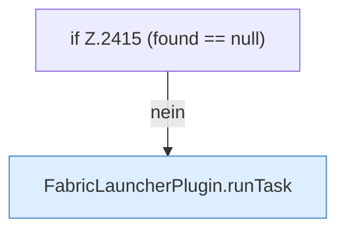

[[00 Start]] › [[Plugin-Kern]] › [[Befehle]] › [[FabricLauncherPlugin.onCommand]] › [[FabricLauncherPlugin.onCommand.Z2401.Case2412.Teil2]]

# FabricLauncherPlugin.onCommand.Z2401.Case2412.Teil2



```knoten
if Z.2415 (found == null)
  Zeile 2415: prüft `(found == null)`.
FabricLauncherPlugin.runTask
  Das [[Glossar#Plugin|Plugin]] führt aus die [[Glossar#Aufgabe|Aufgabe]]. Führt aus `runTask`. Ruft `executeTask`, `noteTask`, `notifyNtfy`.
```

> [!knoten]- Was die Blöcke tun
> - **if Z.2415 (found == null)**: Zeile 2415: prüft `(found == null)`.
> - **FabricLauncherPlugin.runTask**: Das [[Glossar#Plugin|Plugin]] führt aus die [[Glossar#Aufgabe|Aufgabe]]. Führt aus `runTask`. Ruft `executeTask`, `noteTask`, `notifyNtfy`.

- Ein weiterer Abschnitt derselben Übersicht.
- Fortsetzung von `FabricLauncherPlugin.onCommand.Z2401.Case2412`.
