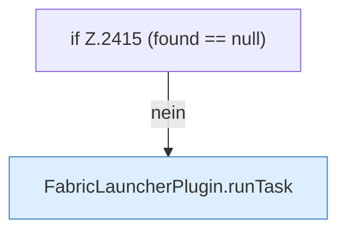

[[00 Start]] › [[Plugin-Kern]] › [[Befehle]] › [[FabricLauncherPlugin.onCommand]] › [[FabricLauncherPlugin.onCommand.Z2401.Case2412.Teil2]]

# FabricLauncherPlugin.onCommand.Z2401.Case2412.Teil2

- Fortsetzung von `FabricLauncherPlugin.onCommand.Z2401.Case2412`, Quellreihenfolge.
