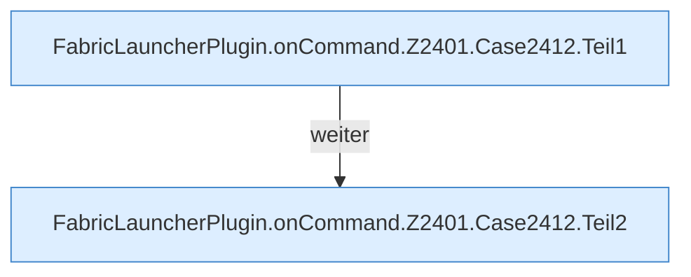

[[00 Start]] › [[Plugin-Kern]] › [[Befehle]] › [[FabricLauncherPlugin.onCommand]] › [[FabricLauncherPlugin.onCommand.Z2401.Case2412]]

# FabricLauncherPlugin.onCommand.Z2401.Case2412



```knoten
FabricLauncherPlugin.onCommand.Z2401.Case2412.Teil1
  Ein weiterer Abschnitt derselben Übersicht. Abschnitt 1 dieses Ablaufs, in Quellreihenfolge.
FabricLauncherPlugin.onCommand.Z2401.Case2412.Teil2
  Ein weiterer Abschnitt derselben Übersicht. Abschnitt 2 dieses Ablaufs, in Quellreihenfolge.
```

> [!knoten]- Was die Blöcke tun
> - **FabricLauncherPlugin.onCommand.Z2401.Case2412.Teil1**: Ein weiterer Abschnitt derselben Übersicht. Abschnitt 1 dieses Ablaufs, in Quellreihenfolge.
> - **FabricLauncherPlugin.onCommand.Z2401.Case2412.Teil2**: Ein weiterer Abschnitt derselben Übersicht. Abschnitt 2 dieses Ablaufs, in Quellreihenfolge.

- Das Innere eines Wegs, ab [[Glossar#Zeile|Zeile]] 2412.
- Fortsetzung von `FabricLauncherPlugin.onCommand.Z2401`.
