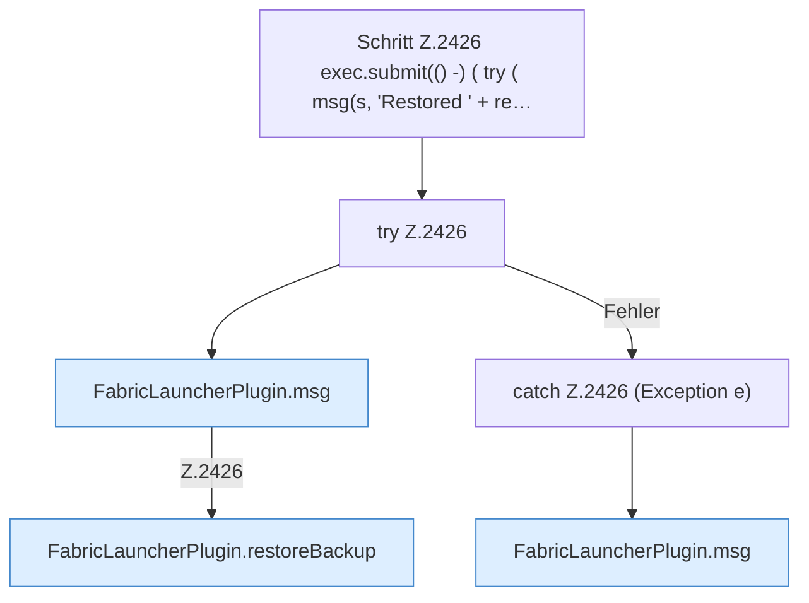

[[00 Start]] › [[Plugin-Kern]] › [[Befehle]] › [[FabricLauncherPlugin.onCommand]] › [[FabricLauncherPlugin.onCommand.Z2401.Case2417.Z2418.Z2421.Z2424.Z2426]]

# FabricLauncherPlugin.onCommand.Z2401.Case2417.Z2418.Z2421.Z2424.Z2426



```knoten
Schritt Z.2426 exec.submit(() -) ( try ( msg(s, 'Restored ' + re…
  Zeile 2426: legt die Arbeit auf den Pool ServerhosterPlugin. `exec.submit(() -) ( try ( msg(s, 'Restored ' + re…`
try Z.2426
  Zeile 2426: Versuch. Der Fehlerpfad geht in catch.
FabricLauncherPlugin.msg
  Schickt eine [[Glossar#Zeile|Zeile]] an den Menschen, der einen [[Glossar#Befehl|Befehl]] getippt hat. Sendet eine Chat-Zeile `msg`.
FabricLauncherPlugin.restoreBackup
  Das [[Glossar#Plugin|Plugin]] stellt wieder her die [[Glossar#Sicherungskopie|Sicherungskopie]]. Stellt wieder her `restoreBackup`. Ruft `slot`, `running`, `remoteBackupSelected`.
catch Z.2426 (Exception e)
  Zeile 2426: fängt (Exception e).
```

> [!knoten]- Was die Blöcke tun
> - **Schritt Z.2426 exec.submit(() -) ( try ( msg(s, 'Restored ' + re…**: Zeile 2426: legt die Arbeit auf den Pool ServerhosterPlugin. `exec.submit(() -) ( try ( msg(s, 'Restored ' + re…`
> - **try Z.2426**: Zeile 2426: Versuch. Der Fehlerpfad geht in catch.
> - **FabricLauncherPlugin.msg**: Schickt eine [[Glossar#Zeile|Zeile]] an den Menschen, der einen [[Glossar#Befehl|Befehl]] getippt hat. Sendet eine Chat-Zeile `msg`.
> - **FabricLauncherPlugin.restoreBackup**: Das [[Glossar#Plugin|Plugin]] stellt wieder her die [[Glossar#Sicherungskopie|Sicherungskopie]]. Stellt wieder her `restoreBackup`. Ruft `slot`, `running`, `remoteBackupSelected`.
> - **catch Z.2426 (Exception e)**: Zeile 2426: fängt (Exception e).

- Der Ablauf geht in [[Glossar#Zeile|Zeile]] 2426 weiter. Eine Ebene tiefer steht er genauer.
- Fortsetzung von `FabricLauncherPlugin.onCommand.Z2401.Case2417.Z2418.Z2421.Z2424`.
