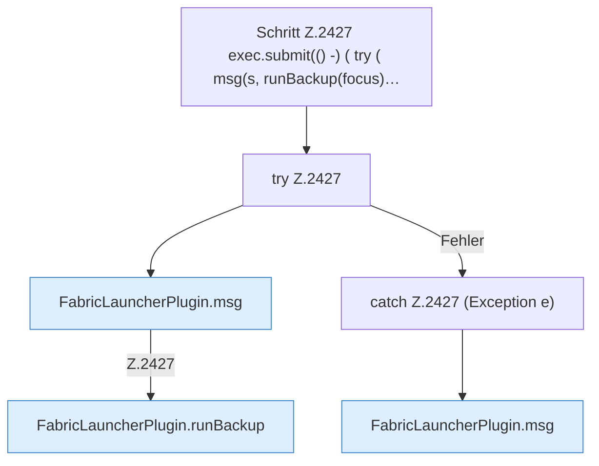

[[00 Start]] › [[Plugin-Kern]] › [[Befehle]] › [[FabricLauncherPlugin.onCommand]] › [[FabricLauncherPlugin.onCommand.Z2401.Case2417.Z2418.Z2421.Z2424.Z2427]]

# FabricLauncherPlugin.onCommand.Z2401.Case2417.Z2418.Z2421.Z2424.Z2427

- Fortsetzung von `FabricLauncherPlugin.onCommand.Z2401.Case2417.Z2418.Z2421.Z2424`, Quellreihenfolge.
