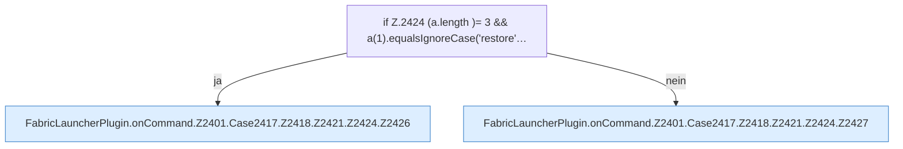

[[00 Start]] › [[Plugin-Kern]] › [[Befehle]] › [[FabricLauncherPlugin.onCommand]] › [[FabricLauncherPlugin.onCommand.Z2401.Case2417.Z2418.Z2421.Z2424]]

# FabricLauncherPlugin.onCommand.Z2401.Case2417.Z2418.Z2421.Z2424

- Fortsetzung von `FabricLauncherPlugin.onCommand.Z2401.Case2417.Z2418.Z2421`, Quellreihenfolge.
