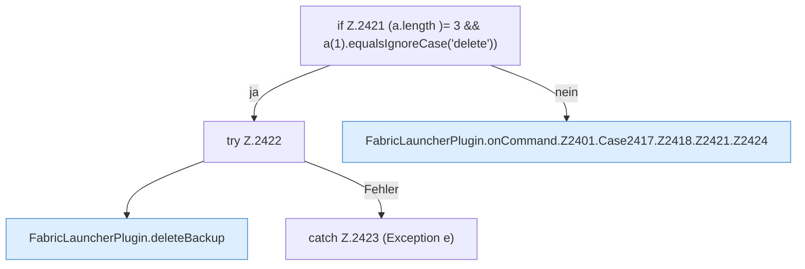

[[00 Start]] › [[Plugin-Kern]] › [[Befehle]] › [[FabricLauncherPlugin.onCommand]] › [[FabricLauncherPlugin.onCommand.Z2401.Case2417.Z2418.Z2421]]

# FabricLauncherPlugin.onCommand.Z2401.Case2417.Z2418.Z2421



```knoten
if Z.2421 (a.length )= 3 && a(1).equalsIgnoreCase('delete'))
  Zeile 2421: prüft `(a.length )= 3 && a(1).equalsIgnoreCase('delete'))`.
try Z.2422
  Zeile 2422: Versuch. Der Fehlerpfad geht in catch.
FabricLauncherPlugin.deleteBackup
  Das [[Glossar#Plugin|Plugin]] löscht die [[Glossar#Sicherungskopie|Sicherungskopie]]. Löscht `deleteBackup`. Ruft `remoteBackupSelected`, `backupCredentials`, `delete`.
catch Z.2423 (Exception e)
  Zeile 2423: fängt (Exception e).
FabricLauncherPlugin.onCommand.Z2401.Case2417.Z2418.Z2421.Z2424
  Der Ablauf geht in [[Glossar#Zeile|Zeile]] 2424 weiter. Eine Ebene tiefer steht er genauer. Fortsetzung des Ablaufs ab Zeile 2424.
```

> [!knoten]- Was die Blöcke tun
> - **if Z.2421 (a.length )= 3 && a(1).equalsIgnoreCase('delete'))**: Zeile 2421: prüft `(a.length )= 3 && a(1).equalsIgnoreCase('delete'))`.
> - **try Z.2422**: Zeile 2422: Versuch. Der Fehlerpfad geht in catch.
> - **FabricLauncherPlugin.deleteBackup**: Das [[Glossar#Plugin|Plugin]] löscht die [[Glossar#Sicherungskopie|Sicherungskopie]]. Löscht `deleteBackup`. Ruft `remoteBackupSelected`, `backupCredentials`, `delete`.
> - **catch Z.2423 (Exception e)**: Zeile 2423: fängt (Exception e).
> - **FabricLauncherPlugin.onCommand.Z2401.Case2417.Z2418.Z2421.Z2424**: Der Ablauf geht in [[Glossar#Zeile|Zeile]] 2424 weiter. Eine Ebene tiefer steht er genauer. Fortsetzung des Ablaufs ab Zeile 2424.

- Der Ablauf geht in [[Glossar#Zeile|Zeile]] 2421 weiter. Eine Ebene tiefer steht er genauer.
- Fortsetzung von `FabricLauncherPlugin.onCommand.Z2401.Case2417.Z2418`.
