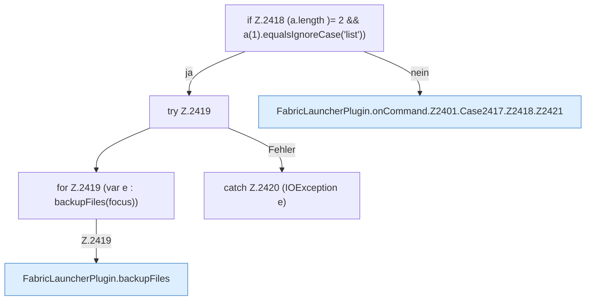

[[00 Start]] › [[Plugin-Kern]] › [[Befehle]] › [[FabricLauncherPlugin.onCommand]] › [[FabricLauncherPlugin.onCommand.Z2401.Case2417.Z2418]]

# FabricLauncherPlugin.onCommand.Z2401.Case2417.Z2418

- Fortsetzung von `FabricLauncherPlugin.onCommand.Z2401.Case2417`, Quellreihenfolge.
