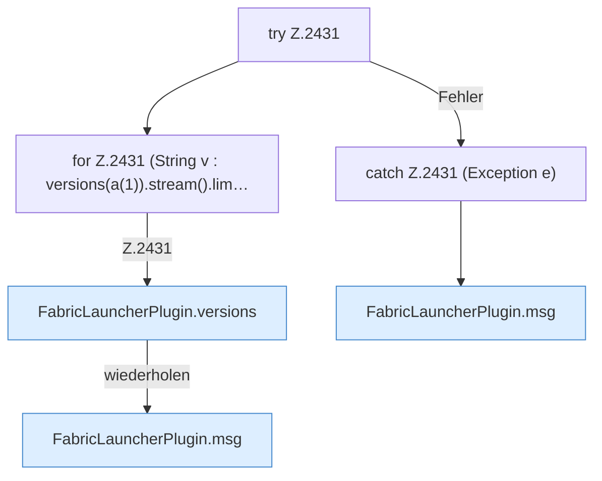

[[00 Start]] › [[Plugin-Kern]] › [[Befehle]] › [[FabricLauncherPlugin.onCommand]] › [[FabricLauncherPlugin.onCommand.Z2401.Case2429.Z2431.Z2431]]

# FabricLauncherPlugin.onCommand.Z2401.Case2429.Z2431.Z2431



```knoten
try Z.2431
  Zeile 2431: Versuch. Der Fehlerpfad geht in catch.
for Z.2431 (String v : versions(a(1)).stream().lim…
  Zeile 2431: Schleife `(String v : versions(a(1)).stream().lim…`.
FabricLauncherPlugin.versions
  Liefert die bekannten [[Glossar#Version|Versionen]]. `versions` in `FabricLauncherPlugin.java`. Ruft `fetch`.
FabricLauncherPlugin.msg
  Schickt eine [[Glossar#Zeile|Zeile]] an den Menschen, der einen [[Glossar#Befehl|Befehl]] getippt hat. Sendet eine Chat-Zeile `msg`.
catch Z.2431 (Exception e)
  Zeile 2431: fängt (Exception e).
```

> [!knoten]- Was die Blöcke tun
> - **try Z.2431**: Zeile 2431: Versuch. Der Fehlerpfad geht in catch.
> - **for Z.2431 (String v : versions(a(1)).stream().lim…**: Zeile 2431: Schleife `(String v : versions(a(1)).stream().lim…`.
> - **FabricLauncherPlugin.versions**: Liefert die bekannten [[Glossar#Version|Versionen]]. `versions` in `FabricLauncherPlugin.java`. Ruft `fetch`.
> - **FabricLauncherPlugin.msg**: Schickt eine [[Glossar#Zeile|Zeile]] an den Menschen, der einen [[Glossar#Befehl|Befehl]] getippt hat. Sendet eine Chat-Zeile `msg`.
> - **catch Z.2431 (Exception e)**: Zeile 2431: fängt (Exception e).

- Der Ablauf geht in [[Glossar#Zeile|Zeile]] 2431 weiter. Eine Ebene tiefer steht er genauer.
- Fortsetzung von `FabricLauncherPlugin.onCommand.Z2401.Case2429.Z2431`.
