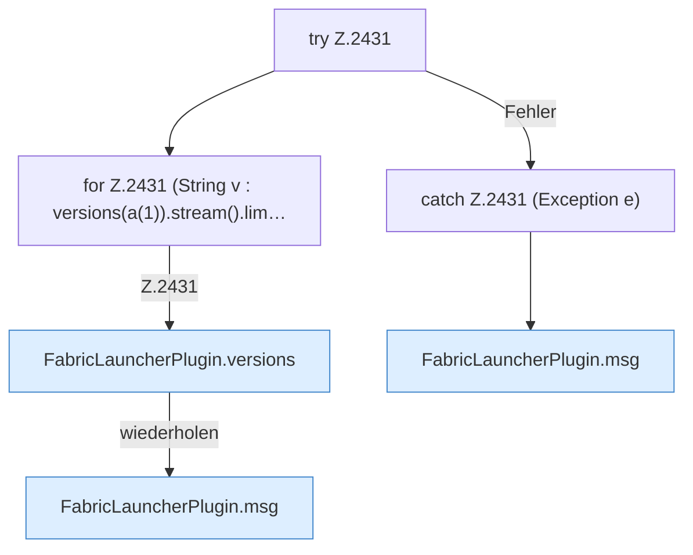

[[00 Start]] › [[Plugin-Kern]] › [[Befehle]] › [[FabricLauncherPlugin.onCommand]] › [[FabricLauncherPlugin.onCommand.Z2401.Case2429.Z2431.Z2431]]

# FabricLauncherPlugin.onCommand.Z2401.Case2429.Z2431.Z2431

- Fortsetzung von `FabricLauncherPlugin.onCommand.Z2401.Case2429.Z2431`, Quellreihenfolge.
