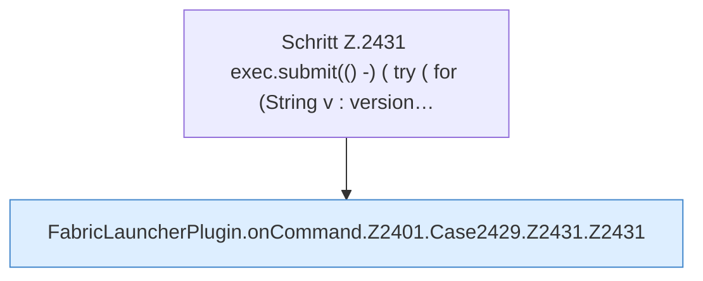

[[00 Start]] › [[Plugin-Kern]] › [[Befehle]] › [[FabricLauncherPlugin.onCommand]] › [[FabricLauncherPlugin.onCommand.Z2401.Case2429.Z2431]]

# FabricLauncherPlugin.onCommand.Z2401.Case2429.Z2431



```knoten
Schritt Z.2431 exec.submit(() -) ( try ( for (String v : version…
  Zeile 2431: legt die Arbeit auf den Pool ServerhosterPlugin. `exec.submit(() -) ( try ( for (String v : version…`
FabricLauncherPlugin.onCommand.Z2401.Case2429.Z2431.Z2431
  Fortsetzung des Ablaufs ab Zeile 2431.
```

- Fortsetzung von `FabricLauncherPlugin.onCommand.Z2401.Case2429`, Quellreihenfolge.
