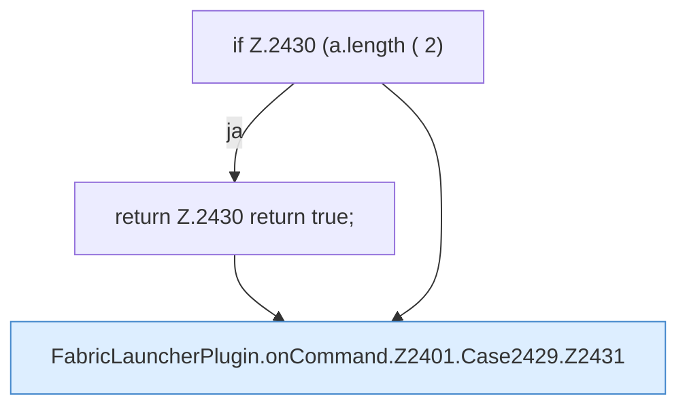

[[00 Start]] › [[Plugin-Kern]] › [[Befehle]] › [[FabricLauncherPlugin.onCommand]] › [[FabricLauncherPlugin.onCommand.Z2401.Case2429]]

# FabricLauncherPlugin.onCommand.Z2401.Case2429



```knoten
if Z.2430 (a.length ( 2)
  Zeile 2430: prüft `(a.length ( 2)`.
return Z.2430 return true;
  Zeile 2430: Rückgabe `return true;`.
FabricLauncherPlugin.onCommand.Z2401.Case2429.Z2431
  Fortsetzung des Ablaufs ab Zeile 2431.
```

- Fortsetzung von `FabricLauncherPlugin.onCommand.Z2401`, Quellreihenfolge.
