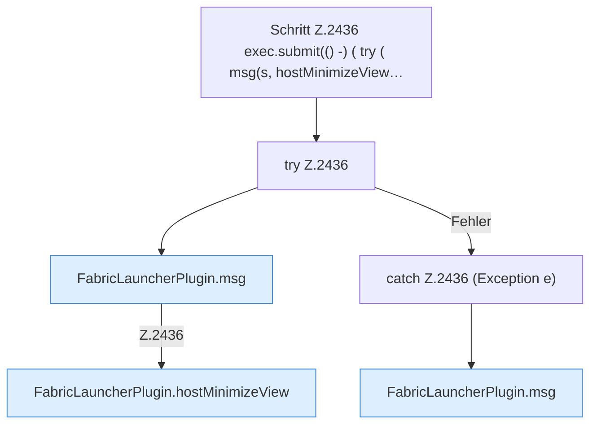

[[00 Start]] › [[Plugin-Kern]] › [[Befehle]] › [[FabricLauncherPlugin.onCommand]] › [[FabricLauncherPlugin.onCommand.Z2401.Case2433.Z2435.Case2436.Z2436]]

# FabricLauncherPlugin.onCommand.Z2401.Case2433.Z2435.Case2436.Z2436



```knoten
Schritt Z.2436 exec.submit(() -) ( try ( msg(s, hostMinimizeView…
  Zeile 2436: legt die Arbeit auf den Pool ServerhosterPlugin. `exec.submit(() -) ( try ( msg(s, hostMinimizeView…`
try Z.2436
  Zeile 2436: Versuch. Der Fehlerpfad geht in catch.
FabricLauncherPlugin.msg
  Schickt eine [[Glossar#Zeile|Zeile]] an den Menschen, der einen [[Glossar#Befehl|Befehl]] getippt hat. Sendet eine Chat-Zeile `msg`.
FabricLauncherPlugin.hostMinimizeView
  Das [[Glossar#Plugin|Plugin]] kümmert sich um das Verkleinern die Ansicht. Betrifft den [[Glossar#Host|Host]] `hostMinimizeView`. Ruft `readHostMinimizeState`, `configuredHostWorld`, `preview`.
catch Z.2436 (Exception e)
  Zeile 2436: fängt (Exception e).
```

> [!knoten]- Was die Blöcke tun
> - **Schritt Z.2436 exec.submit(() -) ( try ( msg(s, hostMinimizeView…**: Zeile 2436: legt die Arbeit auf den Pool ServerhosterPlugin. `exec.submit(() -) ( try ( msg(s, hostMinimizeView…`
> - **try Z.2436**: Zeile 2436: Versuch. Der Fehlerpfad geht in catch.
> - **FabricLauncherPlugin.msg**: Schickt eine [[Glossar#Zeile|Zeile]] an den Menschen, der einen [[Glossar#Befehl|Befehl]] getippt hat. Sendet eine Chat-Zeile `msg`.
> - **FabricLauncherPlugin.hostMinimizeView**: Das [[Glossar#Plugin|Plugin]] kümmert sich um das Verkleinern die Ansicht. Betrifft den [[Glossar#Host|Host]] `hostMinimizeView`. Ruft `readHostMinimizeState`, `configuredHostWorld`, `preview`.
> - **catch Z.2436 (Exception e)**: Zeile 2436: fängt (Exception e).

- Der Ablauf geht in [[Glossar#Zeile|Zeile]] 2436 weiter. Eine Ebene tiefer steht er genauer.
- Fortsetzung von `FabricLauncherPlugin.onCommand.Z2401.Case2433.Z2435.Case2436`.
