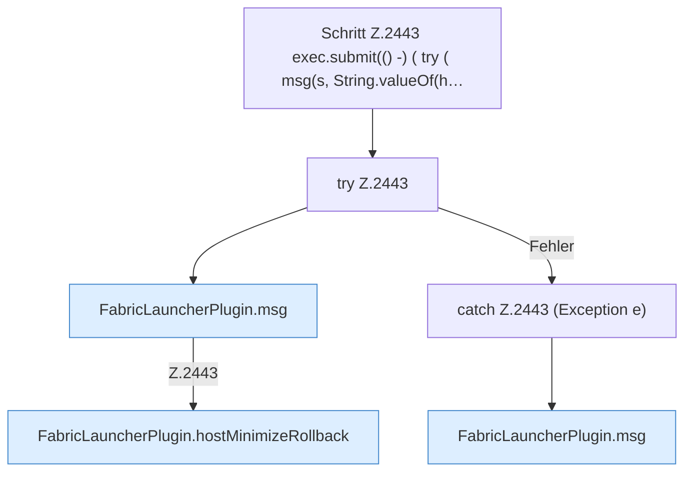

[[00 Start]] › [[Plugin-Kern]] › [[Befehle]] › [[FabricLauncherPlugin.onCommand]] › [[FabricLauncherPlugin.onCommand.Z2401.Case2433.Z2435.Case2441.Z2443]]

# FabricLauncherPlugin.onCommand.Z2401.Case2433.Z2435.Case2441.Z2443



```knoten
Schritt Z.2443 exec.submit(() -) ( try ( msg(s, String.valueOf(h…
  Zeile 2443: legt die Arbeit auf den Pool ServerhosterPlugin. `exec.submit(() -) ( try ( msg(s, String.valueOf(h…`
try Z.2443
  Zeile 2443: Versuch. Der Fehlerpfad geht in catch.
FabricLauncherPlugin.msg
  Schickt eine [[Glossar#Zeile|Zeile]] an den Menschen, der einen [[Glossar#Befehl|Befehl]] getippt hat. Sendet eine Chat-Zeile `msg`.
FabricLauncherPlugin.hostMinimizeRollback
  Das [[Glossar#Plugin|Plugin]] macht hier einen einzelnen Schritt. Eine Ebene tiefer steht er genauer. Betrifft den [[Glossar#Host|Host]] `hostMinimizeRollback`. Ruft `readHostMinimizeState`, `restore`, `getWorldRoot`.
catch Z.2443 (Exception e)
  Zeile 2443: fängt (Exception e).
```

> [!knoten]- Was die Blöcke tun
> - **Schritt Z.2443 exec.submit(() -) ( try ( msg(s, String.valueOf(h…**: Zeile 2443: legt die Arbeit auf den Pool ServerhosterPlugin. `exec.submit(() -) ( try ( msg(s, String.valueOf(h…`
> - **try Z.2443**: Zeile 2443: Versuch. Der Fehlerpfad geht in catch.
> - **FabricLauncherPlugin.msg**: Schickt eine [[Glossar#Zeile|Zeile]] an den Menschen, der einen [[Glossar#Befehl|Befehl]] getippt hat. Sendet eine Chat-Zeile `msg`.
> - **FabricLauncherPlugin.hostMinimizeRollback**: Das [[Glossar#Plugin|Plugin]] macht hier einen einzelnen Schritt. Eine Ebene tiefer steht er genauer. Betrifft den [[Glossar#Host|Host]] `hostMinimizeRollback`. Ruft `readHostMinimizeState`, `restore`, `getWorldRoot`.
> - **catch Z.2443 (Exception e)**: Zeile 2443: fängt (Exception e).

- Der Ablauf geht in [[Glossar#Zeile|Zeile]] 2443 weiter. Eine Ebene tiefer steht er genauer.
- Fortsetzung von `FabricLauncherPlugin.onCommand.Z2401.Case2433.Z2435.Case2441`.
