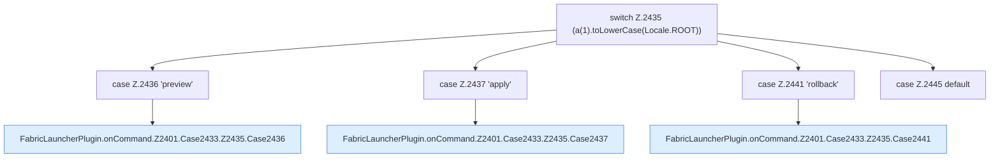

[[00 Start]] › [[Plugin-Kern]] › [[Befehle]] › [[FabricLauncherPlugin.onCommand]] › [[FabricLauncherPlugin.onCommand.Z2401.Case2433.Z2435]]

# FabricLauncherPlugin.onCommand.Z2401.Case2433.Z2435



```knoten
switch Z.2435 (a(1).toLowerCase(Locale.ROOT))
  Zeile 2435: Verzweigung nach `(a(1).toLowerCase(Locale.ROOT))`.
case Z.2436 'preview'
  Zeile 2436: Zweig `'preview'`.
FabricLauncherPlugin.onCommand.Z2401.Case2433.Z2435.Case2436
  Das Innere eines Wegs, ab [[Glossar#Zeile|Zeile]] 2436. Rumpf dieses switch-Zweigs ab Zeile 2436.
case Z.2437 'apply'
  Zeile 2437: Zweig `'apply'`.
FabricLauncherPlugin.onCommand.Z2401.Case2433.Z2435.Case2437
  Das Innere eines Wegs, ab [[Glossar#Zeile|Zeile]] 2437. Rumpf dieses switch-Zweigs ab Zeile 2437.
case Z.2441 'rollback'
  Zeile 2441: Zweig `'rollback'`.
FabricLauncherPlugin.onCommand.Z2401.Case2433.Z2435.Case2441
  Das Innere eines Wegs, ab [[Glossar#Zeile|Zeile]] 2441. Rumpf dieses switch-Zweigs ab Zeile 2441.
case Z.2445 default
  Zeile 2445: Zweig `default`.
```

> [!knoten]- Was die Blöcke tun
> - **switch Z.2435 (a(1).toLowerCase(Locale.ROOT))**: Zeile 2435: Verzweigung nach `(a(1).toLowerCase(Locale.ROOT))`.
> - **case Z.2436 'preview'**: Zeile 2436: Zweig `'preview'`.
> - **FabricLauncherPlugin.onCommand.Z2401.Case2433.Z2435.Case2436**: Das Innere eines Wegs, ab [[Glossar#Zeile|Zeile]] 2436. Rumpf dieses switch-Zweigs ab Zeile 2436.
> - **case Z.2437 'apply'**: Zeile 2437: Zweig `'apply'`.
> - **FabricLauncherPlugin.onCommand.Z2401.Case2433.Z2435.Case2437**: Das Innere eines Wegs, ab [[Glossar#Zeile|Zeile]] 2437. Rumpf dieses switch-Zweigs ab Zeile 2437.
> - **case Z.2441 'rollback'**: Zeile 2441: Zweig `'rollback'`.
> - **FabricLauncherPlugin.onCommand.Z2401.Case2433.Z2435.Case2441**: Das Innere eines Wegs, ab [[Glossar#Zeile|Zeile]] 2441. Rumpf dieses switch-Zweigs ab Zeile 2441.
> - **case Z.2445 default**: Zeile 2445: Zweig `default`.

- Der Ablauf geht in [[Glossar#Zeile|Zeile]] 2435 weiter. Eine Ebene tiefer steht er genauer.
- Fortsetzung von `FabricLauncherPlugin.onCommand.Z2401.Case2433`.
