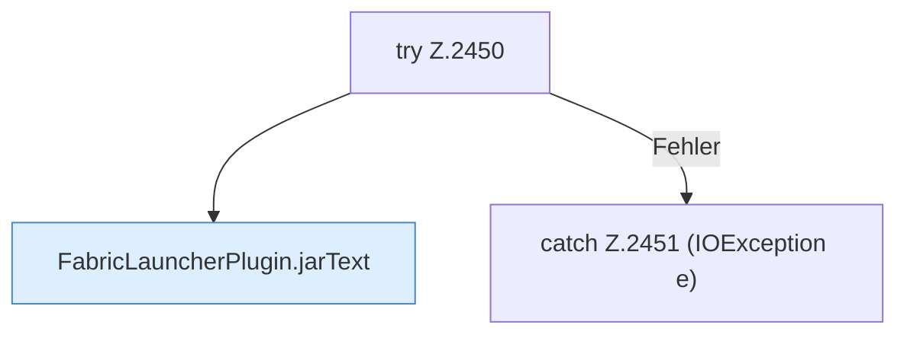

[[00 Start]] › [[Plugin-Kern]] › [[Befehle]] › [[FabricLauncherPlugin.onCommand]] › [[FabricLauncherPlugin.onCommand.Z2401.Case2449]]

# FabricLauncherPlugin.onCommand.Z2401.Case2449



```knoten
try Z.2450
  Zeile 2450: Versuch. Der Fehlerpfad geht in catch.
FabricLauncherPlugin.jarText
  Betrifft das Jar `jarText`. Ruft `text`, `inspect`, `profile`.
catch Z.2451 (IOException e)
  Zeile 2451: fängt (IOException e).
```

- Fortsetzung von `FabricLauncherPlugin.onCommand.Z2401`, Quellreihenfolge.
