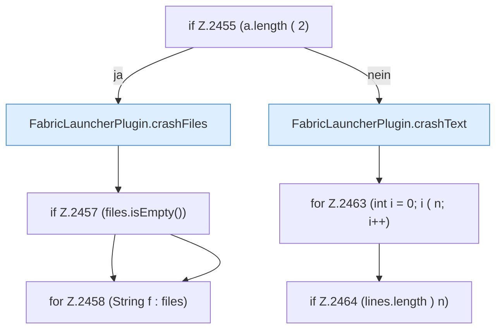

[[00 Start]] › [[Plugin-Kern]] › [[Befehle]] › [[FabricLauncherPlugin.onCommand]] › [[FabricLauncherPlugin.onCommand.Z2401.Case2453.Z2454.Z2455]]

# FabricLauncherPlugin.onCommand.Z2401.Case2453.Z2454.Z2455

- Fortsetzung von `FabricLauncherPlugin.onCommand.Z2401.Case2453.Z2454`, Quellreihenfolge.
