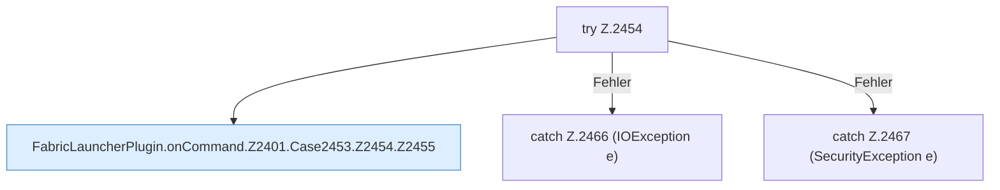

[[00 Start]] › [[Plugin-Kern]] › [[Befehle]] › [[FabricLauncherPlugin.onCommand]] › [[FabricLauncherPlugin.onCommand.Z2401.Case2453.Z2454]]

# FabricLauncherPlugin.onCommand.Z2401.Case2453.Z2454



```knoten
try Z.2454
  Zeile 2454: Versuch. Der Fehlerpfad geht in catch.
FabricLauncherPlugin.onCommand.Z2401.Case2453.Z2454.Z2455
  Der Ablauf geht in [[Glossar#Zeile|Zeile]] 2455 weiter. Eine Ebene tiefer steht er genauer. Fortsetzung des Ablaufs ab Zeile 2455.
catch Z.2466 (IOException e)
  Zeile 2466: fängt (IOException e).
catch Z.2467 (SecurityException e)
  Zeile 2467: fängt (SecurityException e).
```

> [!knoten]- Was die Blöcke tun
> - **try Z.2454**: Zeile 2454: Versuch. Der Fehlerpfad geht in catch.
> - **FabricLauncherPlugin.onCommand.Z2401.Case2453.Z2454.Z2455**: Der Ablauf geht in [[Glossar#Zeile|Zeile]] 2455 weiter. Eine Ebene tiefer steht er genauer. Fortsetzung des Ablaufs ab Zeile 2455.
> - **catch Z.2466 (IOException e)**: Zeile 2466: fängt (IOException e).
> - **catch Z.2467 (SecurityException e)**: Zeile 2467: fängt (SecurityException e).

- Der Ablauf geht in [[Glossar#Zeile|Zeile]] 2454 weiter. Eine Ebene tiefer steht er genauer.
- Fortsetzung von `FabricLauncherPlugin.onCommand.Z2401.Case2453`.
