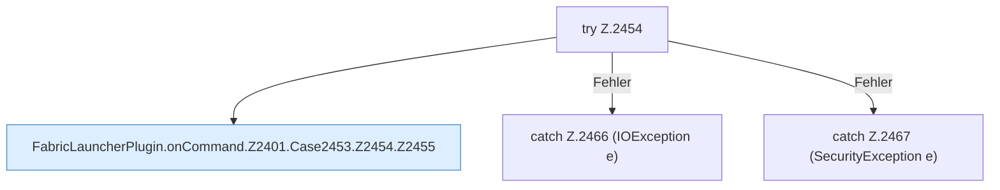

[[00 Start]] › [[Plugin-Kern]] › [[Befehle]] › [[FabricLauncherPlugin.onCommand]] › [[FabricLauncherPlugin.onCommand.Z2401.Case2453.Z2454]]

# FabricLauncherPlugin.onCommand.Z2401.Case2453.Z2454

- Fortsetzung von `FabricLauncherPlugin.onCommand.Z2401.Case2453`, Quellreihenfolge.
