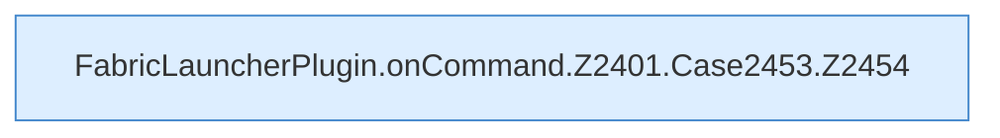

[[00 Start]] › [[Plugin-Kern]] › [[Befehle]] › [[FabricLauncherPlugin.onCommand]] › [[FabricLauncherPlugin.onCommand.Z2401.Case2453]]

# FabricLauncherPlugin.onCommand.Z2401.Case2453



```knoten
FabricLauncherPlugin.onCommand.Z2401.Case2453.Z2454
  Der Ablauf geht in [[Glossar#Zeile|Zeile]] 2454 weiter. Eine Ebene tiefer steht er genauer. Fortsetzung des Ablaufs ab Zeile 2454.
```

> [!knoten]- Was die Blöcke tun
> - **FabricLauncherPlugin.onCommand.Z2401.Case2453.Z2454**: Der Ablauf geht in [[Glossar#Zeile|Zeile]] 2454 weiter. Eine Ebene tiefer steht er genauer. Fortsetzung des Ablaufs ab Zeile 2454.

- Das Innere eines Wegs, ab [[Glossar#Zeile|Zeile]] 2453.
- Fortsetzung von `FabricLauncherPlugin.onCommand.Z2401`.
