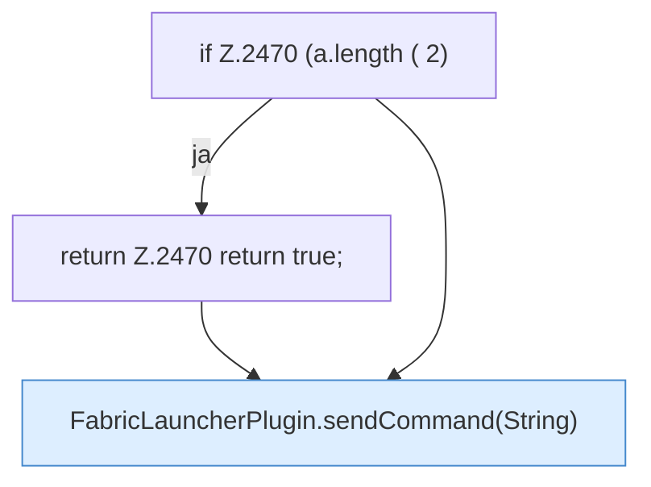

[[00 Start]] › [[Plugin-Kern]] › [[Befehle]] › [[FabricLauncherPlugin.onCommand]] › [[FabricLauncherPlugin.onCommand.Z2401.Case2469]]

# FabricLauncherPlugin.onCommand.Z2401.Case2469



```knoten
if Z.2470 (a.length ( 2)
  Zeile 2470: prüft `(a.length ( 2)`.
return Z.2470 return true;
  Zeile 2470: Rückgabe `return true;`.
FabricLauncherPlugin.sendCommand(String)
  Sendet `sendCommand`. Ruft `sendCommand`.
```

- Fortsetzung von `FabricLauncherPlugin.onCommand.Z2401`, Quellreihenfolge.
