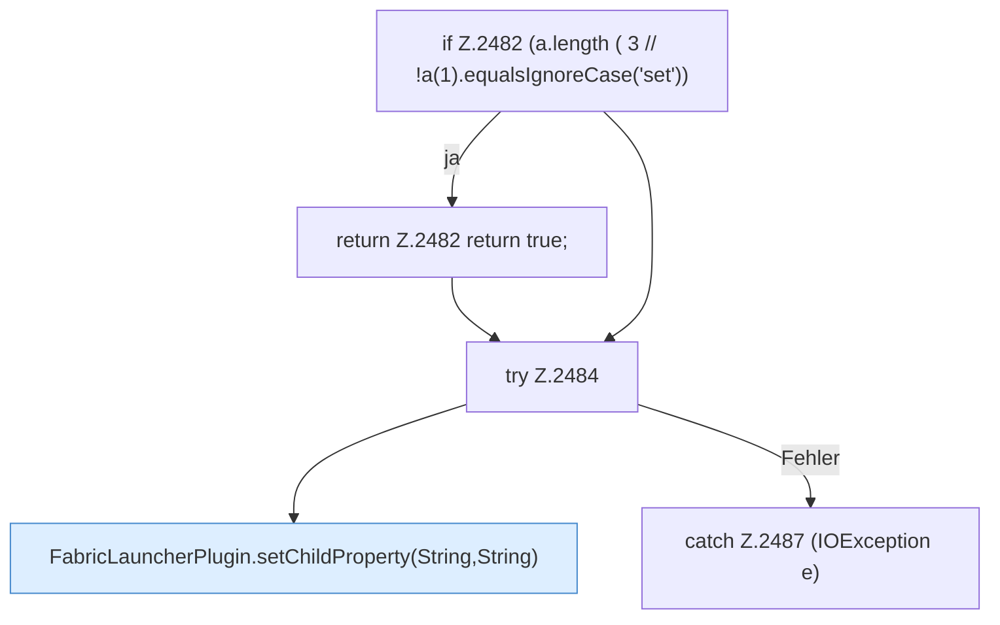

[[00 Start]] › [[Plugin-Kern]] › [[Befehle]] › [[FabricLauncherPlugin.onCommand]] › [[FabricLauncherPlugin.onCommand.Z2401.Case2481]]

# FabricLauncherPlugin.onCommand.Z2401.Case2481



```knoten
if Z.2482 (a.length ( 3 // !a(1).equalsIgnoreCase('set'))
  Zeile 2482: prüft `(a.length ( 3 // !a(1).equalsIgnoreCase('set'))`.
return Z.2482 return true;
  Zeile 2482: Rückgabe `return true;`.
try Z.2484
  Zeile 2484: Versuch. Der Fehlerpfad geht in catch.
FabricLauncherPlugin.setChildProperty(String,String)
  Das [[Glossar#Plugin|Plugin]] setzt den [[Glossar#Spielserver|Spielserver]] eine Eigenschaft. Setzt `setChildProperty`. Ruft `setChildProperty`.
catch Z.2487 (IOException e)
  Zeile 2487: fängt (IOException e).
```

> [!knoten]- Was die Blöcke tun
> - **if Z.2482 (a.length ( 3 // !a(1).equalsIgnoreCase('set'))**: Zeile 2482: prüft `(a.length ( 3 // !a(1).equalsIgnoreCase('set'))`.
> - **return Z.2482 return true;**: Zeile 2482: Rückgabe `return true;`.
> - **try Z.2484**: Zeile 2484: Versuch. Der Fehlerpfad geht in catch.
> - **FabricLauncherPlugin.setChildProperty(String,String)**: Das [[Glossar#Plugin|Plugin]] setzt den [[Glossar#Spielserver|Spielserver]] eine Eigenschaft. Setzt `setChildProperty`. Ruft `setChildProperty`.
> - **catch Z.2487 (IOException e)**: Zeile 2487: fängt (IOException e).

- Das Innere eines Wegs, ab [[Glossar#Zeile|Zeile]] 2481.
- Fortsetzung von `FabricLauncherPlugin.onCommand.Z2401`.
