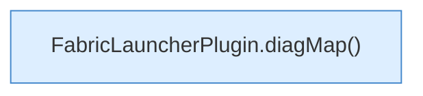

[[00 Start]] › [[Plugin-Kern]] › [[Befehle]] › [[FabricLauncherPlugin.onCommand]] › [[FabricLauncherPlugin.onCommand.Z2401.Case2489]]

# FabricLauncherPlugin.onCommand.Z2401.Case2489



```knoten
FabricLauncherPlugin.diagMap()
  Sammelt die [[Glossar#Diagnose|Diagnose]] in einer Übersicht. Sammelt die Diagnose `diagMap`. Ruft `diagMap`.
```

> [!knoten]- Was die Blöcke tun
> - **FabricLauncherPlugin.diagMap()**: Sammelt die [[Glossar#Diagnose|Diagnose]] in einer Übersicht. Sammelt die Diagnose `diagMap`. Ruft `diagMap`.

- Das Innere eines Wegs, ab [[Glossar#Zeile|Zeile]] 2489.
- Fortsetzung von `FabricLauncherPlugin.onCommand.Z2401`.
