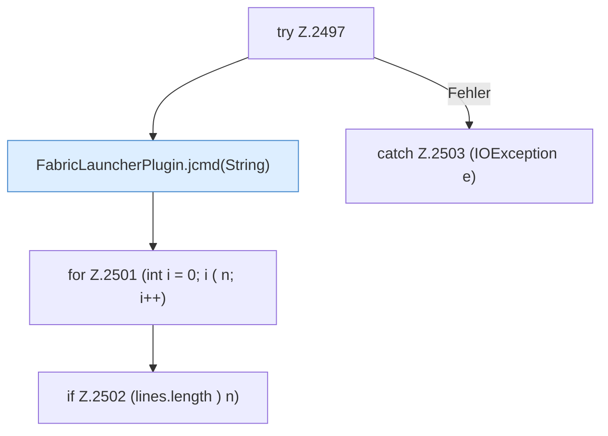

[[00 Start]] › [[Plugin-Kern]] › [[Befehle]] › [[FabricLauncherPlugin.onCommand]] › [[FabricLauncherPlugin.onCommand.Z2401.Case2495.Z2497]]

# FabricLauncherPlugin.onCommand.Z2401.Case2495.Z2497



```knoten
try Z.2497
  Zeile 2497: Versuch. Der Fehlerpfad geht in catch.
FabricLauncherPlugin.jcmd(String)
  `jcmd` in `FabricLauncherPlugin.java`. Ruft `jcmd`.
for Z.2501 (int i = 0; i ( n; i++)
  Zeile 2501: Schleife `(int i = 0; i ( n; i++)`.
if Z.2502 (lines.length ) n)
  Zeile 2502: prüft `(lines.length ) n)`.
catch Z.2503 (IOException e)
  Zeile 2503: fängt (IOException e).
```

- Fortsetzung von `FabricLauncherPlugin.onCommand.Z2401.Case2495`, Quellreihenfolge.
