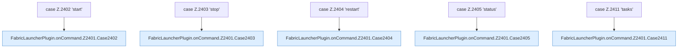

[[00 Start]] › [[Plugin-Kern]] › [[Befehle]] › [[FabricLauncherPlugin.onCommand]] › [[FabricLauncherPlugin.onCommand.Z2401.Cases2402]]

# FabricLauncherPlugin.onCommand.Z2401.Cases2402



```knoten
case Z.2402 'start'
  Zeile 2402: Zweig `'start'`.
FabricLauncherPlugin.onCommand.Z2401.Case2402
  Das Innere eines Wegs, ab [[Glossar#Zeile|Zeile]] 2402. Rumpf dieses switch-Zweigs ab Zeile 2402.
case Z.2403 'stop'
  Zeile 2403: Zweig `'stop'`.
FabricLauncherPlugin.onCommand.Z2401.Case2403
  Das Innere eines Wegs, ab [[Glossar#Zeile|Zeile]] 2403. Rumpf dieses switch-Zweigs ab Zeile 2403.
case Z.2404 'restart'
  Zeile 2404: Zweig `'restart'`.
FabricLauncherPlugin.onCommand.Z2401.Case2404
  Das Innere eines Wegs, ab [[Glossar#Zeile|Zeile]] 2404. Rumpf dieses switch-Zweigs ab Zeile 2404.
case Z.2405 'status'
  Zeile 2405: Zweig `'status'`.
FabricLauncherPlugin.onCommand.Z2401.Case2405
  Das Innere eines Wegs, ab [[Glossar#Zeile|Zeile]] 2405. Rumpf dieses switch-Zweigs ab Zeile 2405.
case Z.2411 'tasks'
  Zeile 2411: Zweig `'tasks'`.
FabricLauncherPlugin.onCommand.Z2401.Case2411
  Das Innere eines Wegs, ab [[Glossar#Zeile|Zeile]] 2411. Rumpf dieses switch-Zweigs ab Zeile 2411.
```

> [!knoten]- Was die Blöcke tun
> - **case Z.2402 'start'**: Zeile 2402: Zweig `'start'`.
> - **FabricLauncherPlugin.onCommand.Z2401.Case2402**: Das Innere eines Wegs, ab [[Glossar#Zeile|Zeile]] 2402. Rumpf dieses switch-Zweigs ab Zeile 2402.
> - **case Z.2403 'stop'**: Zeile 2403: Zweig `'stop'`.
> - **FabricLauncherPlugin.onCommand.Z2401.Case2403**: Das Innere eines Wegs, ab [[Glossar#Zeile|Zeile]] 2403. Rumpf dieses switch-Zweigs ab Zeile 2403.
> - **case Z.2404 'restart'**: Zeile 2404: Zweig `'restart'`.
> - **FabricLauncherPlugin.onCommand.Z2401.Case2404**: Das Innere eines Wegs, ab [[Glossar#Zeile|Zeile]] 2404. Rumpf dieses switch-Zweigs ab Zeile 2404.
> - **case Z.2405 'status'**: Zeile 2405: Zweig `'status'`.
> - **FabricLauncherPlugin.onCommand.Z2401.Case2405**: Das Innere eines Wegs, ab [[Glossar#Zeile|Zeile]] 2405. Rumpf dieses switch-Zweigs ab Zeile 2405.
> - **case Z.2411 'tasks'**: Zeile 2411: Zweig `'tasks'`.
> - **FabricLauncherPlugin.onCommand.Z2401.Case2411**: Das Innere eines Wegs, ab [[Glossar#Zeile|Zeile]] 2411. Rumpf dieses switch-Zweigs ab Zeile 2411.

- Weitere Wege der Entscheidung in [[Glossar#Zeile|Zeile]] 2402.
- Fortsetzung von `FabricLauncherPlugin.onCommand.Z2401`.
