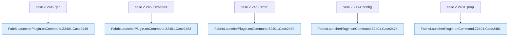

[[00 Start]] › [[Plugin-Kern]] › [[Befehle]] › [[FabricLauncherPlugin.onCommand]] › [[FabricLauncherPlugin.onCommand.Z2401.Cases2449]]

# FabricLauncherPlugin.onCommand.Z2401.Cases2449



```knoten
case Z.2449 'jar'
  Zeile 2449: Zweig `'jar'`.
FabricLauncherPlugin.onCommand.Z2401.Case2449
  Rumpf dieses switch-Zweigs ab Zeile 2449.
case Z.2453 'crashes'
  Zeile 2453: Zweig `'crashes'`.
FabricLauncherPlugin.onCommand.Z2401.Case2453
  Rumpf dieses switch-Zweigs ab Zeile 2453.
case Z.2469 'cmd'
  Zeile 2469: Zweig `'cmd'`.
FabricLauncherPlugin.onCommand.Z2401.Case2469
  Rumpf dieses switch-Zweigs ab Zeile 2469.
case Z.2474 'config'
  Zeile 2474: Zweig `'config'`.
FabricLauncherPlugin.onCommand.Z2401.Case2474
  Rumpf dieses switch-Zweigs ab Zeile 2474.
case Z.2481 'prop'
  Zeile 2481: Zweig `'prop'`.
FabricLauncherPlugin.onCommand.Z2401.Case2481
  Rumpf dieses switch-Zweigs ab Zeile 2481.
```

- Fortsetzung von `FabricLauncherPlugin.onCommand.Z2401`, Quellreihenfolge.
