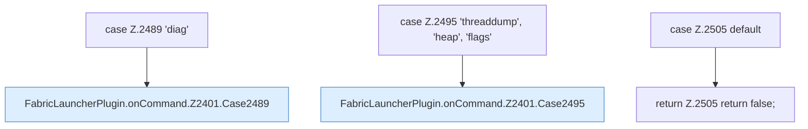

[[00 Start]] › [[Plugin-Kern]] › [[Befehle]] › [[FabricLauncherPlugin.onCommand]] › [[FabricLauncherPlugin.onCommand.Z2401.Cases2489]]

# FabricLauncherPlugin.onCommand.Z2401.Cases2489



```knoten
case Z.2489 'diag'
  Zeile 2489: Zweig `'diag'`.
FabricLauncherPlugin.onCommand.Z2401.Case2489
  Das Innere eines Wegs, ab [[Glossar#Zeile|Zeile]] 2489. Rumpf dieses switch-Zweigs ab Zeile 2489.
case Z.2495 'threaddump', 'heap', 'flags'
  Zeile 2495: Zweig `'threaddump', 'heap', 'flags'`.
FabricLauncherPlugin.onCommand.Z2401.Case2495
  Das Innere eines Wegs, ab [[Glossar#Zeile|Zeile]] 2495. Rumpf dieses switch-Zweigs ab Zeile 2495.
case Z.2505 default
  Zeile 2505: Zweig `default`.
return Z.2505 return false;
  Zeile 2505: Rückgabe `return false;`.
```

> [!knoten]- Was die Blöcke tun
> - **case Z.2489 'diag'**: Zeile 2489: Zweig `'diag'`.
> - **FabricLauncherPlugin.onCommand.Z2401.Case2489**: Das Innere eines Wegs, ab [[Glossar#Zeile|Zeile]] 2489. Rumpf dieses switch-Zweigs ab Zeile 2489.
> - **case Z.2495 'threaddump', 'heap', 'flags'**: Zeile 2495: Zweig `'threaddump', 'heap', 'flags'`.
> - **FabricLauncherPlugin.onCommand.Z2401.Case2495**: Das Innere eines Wegs, ab [[Glossar#Zeile|Zeile]] 2495. Rumpf dieses switch-Zweigs ab Zeile 2495.
> - **case Z.2505 default**: Zeile 2505: Zweig `default`.
> - **return Z.2505 return false;**: Zeile 2505: Rückgabe `return false;`.

- Weitere Wege der Entscheidung in [[Glossar#Zeile|Zeile]] 2489.
- Fortsetzung von `FabricLauncherPlugin.onCommand.Z2401`.
