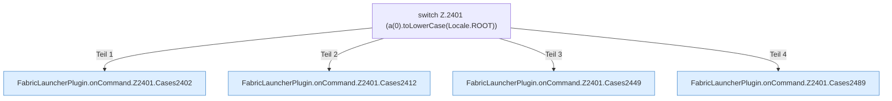

[[00 Start]] › [[Plugin-Kern]] › [[Befehle]] › [[FabricLauncherPlugin.onCommand]] › [[FabricLauncherPlugin.onCommand.Z2401]]

# FabricLauncherPlugin.onCommand.Z2401



```knoten
switch Z.2401 (a(0).toLowerCase(Locale.ROOT))
  Zeile 2401: Verzweigung nach `(a(0).toLowerCase(Locale.ROOT))`.
FabricLauncherPlugin.onCommand.Z2401.Cases2402
  Weitere Wege der Entscheidung in [[Glossar#Zeile|Zeile]] 2402. Weitere switch-Zweige ab Zeile 2402.
FabricLauncherPlugin.onCommand.Z2401.Cases2412
  Weitere Wege der Entscheidung in [[Glossar#Zeile|Zeile]] 2412. Weitere switch-Zweige ab Zeile 2412.
FabricLauncherPlugin.onCommand.Z2401.Cases2449
  Weitere Wege der Entscheidung in [[Glossar#Zeile|Zeile]] 2449. Weitere switch-Zweige ab Zeile 2449.
FabricLauncherPlugin.onCommand.Z2401.Cases2489
  Weitere Wege der Entscheidung in [[Glossar#Zeile|Zeile]] 2489. Weitere switch-Zweige ab Zeile 2489.
```

> [!knoten]- Was die Blöcke tun
> - **switch Z.2401 (a(0).toLowerCase(Locale.ROOT))**: Zeile 2401: Verzweigung nach `(a(0).toLowerCase(Locale.ROOT))`.
> - **FabricLauncherPlugin.onCommand.Z2401.Cases2402**: Weitere Wege der Entscheidung in [[Glossar#Zeile|Zeile]] 2402. Weitere switch-Zweige ab Zeile 2402.
> - **FabricLauncherPlugin.onCommand.Z2401.Cases2412**: Weitere Wege der Entscheidung in [[Glossar#Zeile|Zeile]] 2412. Weitere switch-Zweige ab Zeile 2412.
> - **FabricLauncherPlugin.onCommand.Z2401.Cases2449**: Weitere Wege der Entscheidung in [[Glossar#Zeile|Zeile]] 2449. Weitere switch-Zweige ab Zeile 2449.
> - **FabricLauncherPlugin.onCommand.Z2401.Cases2489**: Weitere Wege der Entscheidung in [[Glossar#Zeile|Zeile]] 2489. Weitere switch-Zweige ab Zeile 2489.

- Der Ablauf geht in [[Glossar#Zeile|Zeile]] 2401 weiter. Eine Ebene tiefer steht er genauer.
- Fortsetzung von `FabricLauncherPlugin.onCommand`.
