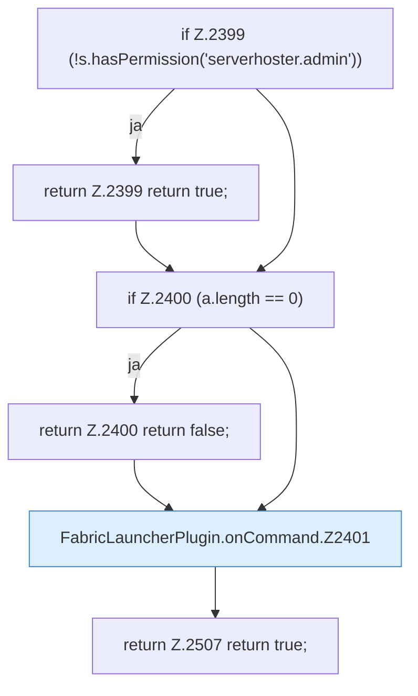

[[00 Start]] › [[Plugin-Kern]] › [[Befehle]] › [[FabricLauncherPlugin.onCommand]]

# FabricLauncherPlugin.onCommand

`FabricLauncherPlugin.onCommand(CommandSender s, Command command, String label, String[] a)` [src/main/java/de/aichele/childlauncher/FabricLauncherPlugin.java:2398–2508](https://github.com/Sciddie/minecraft-serverhoster-plugin/blob/95b02b953b0b4c23673e900e021a7c3c844aa37d/src/main/java/de/aichele/childlauncher/FabricLauncherPlugin.java#L2398-L2508)



```knoten
if Z.2399 (!s.hasPermission('serverhoster.admin'))
  Hier fällt eine Entscheidung. Nur wenn sie zutrifft, geht es den Ja-Weg weiter. Das steht in [[Glossar#Zeile|Zeile]] 2399.
return Z.2399 return true;
  Hier endet die [[Glossar#Funktion|Funktion]] und liefert ein Ergebnis zurück. Das steht in [[Glossar#Zeile|Zeile]] 2399.
if Z.2400 (a.length == 0)
  Hier fällt eine Entscheidung. Nur wenn sie zutrifft, geht es den Ja-Weg weiter. Das steht in [[Glossar#Zeile|Zeile]] 2400.
return Z.2400 return false;
  Hier endet die [[Glossar#Funktion|Funktion]] und liefert ein Ergebnis zurück. Das steht in [[Glossar#Zeile|Zeile]] 2400.
FabricLauncherPlugin.onCommand.Z2401
  Der Ablauf geht in [[Glossar#Zeile|Zeile]] 2401 weiter. Eine Ebene tiefer steht er genauer. Im [[Glossar#Quelltext|Quelltext]] heißt das `Z2401`.
return Z.2507 return true;
  Hier endet die [[Glossar#Funktion|Funktion]] und liefert ein Ergebnis zurück. Das steht in [[Glossar#Zeile|Zeile]] 2507.
```

> [!knoten]- Was die Blöcke tun
> - **if Z.2399 (!s.hasPermission('serverhoster.admin'))**: Hier fällt eine Entscheidung. Nur wenn sie zutrifft, geht es den Ja-Weg weiter. Das steht in [[Glossar#Zeile|Zeile]] 2399.
> - **return Z.2399 return true;**: Hier endet die [[Glossar#Funktion|Funktion]] und liefert ein Ergebnis zurück. Das steht in [[Glossar#Zeile|Zeile]] 2399.
> - **if Z.2400 (a.length == 0)**: Hier fällt eine Entscheidung. Nur wenn sie zutrifft, geht es den Ja-Weg weiter. Das steht in [[Glossar#Zeile|Zeile]] 2400.
> - **return Z.2400 return false;**: Hier endet die [[Glossar#Funktion|Funktion]] und liefert ein Ergebnis zurück. Das steht in [[Glossar#Zeile|Zeile]] 2400.
> - **FabricLauncherPlugin.onCommand.Z2401**: Der Ablauf geht in [[Glossar#Zeile|Zeile]] 2401 weiter. Eine Ebene tiefer steht er genauer. Im [[Glossar#Quelltext|Quelltext]] heißt das `Z2401`.
> - **return Z.2507 return true;**: Hier endet die [[Glossar#Funktion|Funktion]] und liefert ein Ergebnis zurück. Das steht in [[Glossar#Zeile|Zeile]] 2507.

- Nimmt den [[Glossar#Befehl|Befehl]] /child entgegen, zum Beispiel Start, [[Glossar#Stopp|Stopp]], Status oder [[Glossar#Sicherungskopie|Sicherungskopie]].
