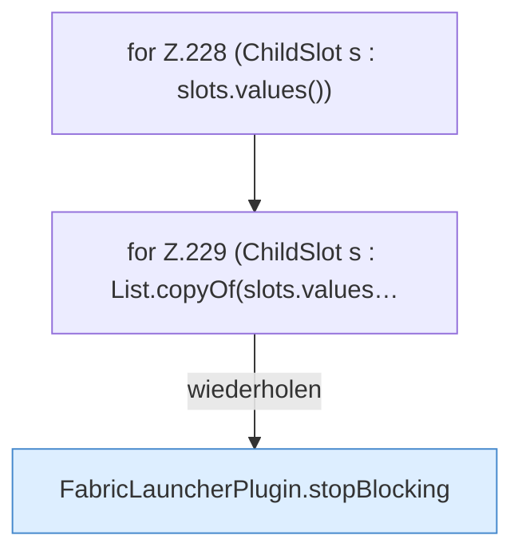

[[00 Start]] › [[Plugin-Kern]] › [[Lebenszyklus]] › [[FabricLauncherPlugin.onDisable]] › [[FabricLauncherPlugin.onDisable.Teil1]]

# FabricLauncherPlugin.onDisable.Teil1



```knoten
for Z.228 (ChildSlot s : slots.values())
  Zeile 228: Schleife `(ChildSlot s : slots.values())`.
for Z.229 (ChildSlot s : List.copyOf(slots.values…
  Zeile 229: Schleife `(ChildSlot s : List.copyOf(slots.values…`.
FabricLauncherPlugin.stopBlocking
  Setzt den Zustand auf „stoppt“ und wartet, bis der [[Glossar#Spielserver|Spielserver]] wirklich aus ist. Stoppt `stopBlocking`. Ruft `invalidateRestarts`, `running`, `stopProcess`.
```

> [!knoten]- Was die Blöcke tun
> - **for Z.228 (ChildSlot s : slots.values())**: Zeile 228: Schleife `(ChildSlot s : slots.values())`.
> - **for Z.229 (ChildSlot s : List.copyOf(slots.values…**: Zeile 229: Schleife `(ChildSlot s : List.copyOf(slots.values…`.
> - **FabricLauncherPlugin.stopBlocking**: Setzt den Zustand auf „stoppt“ und wartet, bis der [[Glossar#Spielserver|Spielserver]] wirklich aus ist. Stoppt `stopBlocking`. Ruft `invalidateRestarts`, `running`, `stopProcess`.

- Ein weiterer Abschnitt derselben Übersicht.
- Fortsetzung von `FabricLauncherPlugin.onDisable`.
