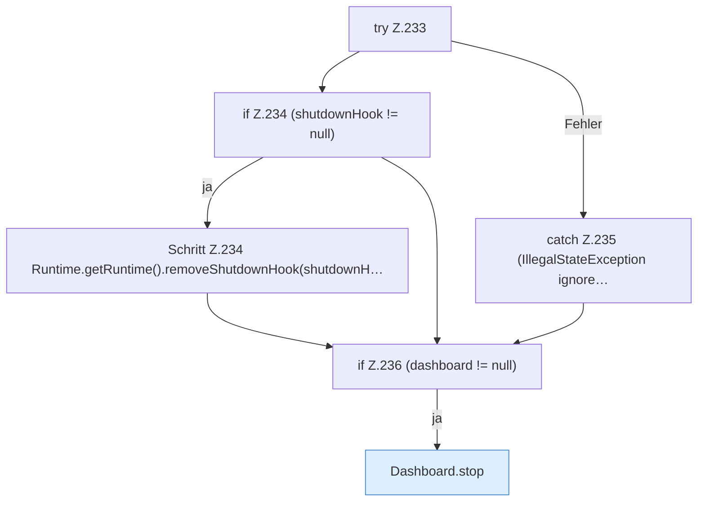

[[00 Start]] › [[Plugin-Kern]] › [[Lebenszyklus]] › [[FabricLauncherPlugin.onDisable]] › [[FabricLauncherPlugin.onDisable.Teil2]]

# FabricLauncherPlugin.onDisable.Teil2



```knoten
try Z.233
  Zeile 233: Versuch. Der Fehlerpfad geht in catch.
if Z.234 (shutdownHook != null)
  Zeile 234: prüft `(shutdownHook != null)`.
Schritt Z.234 Runtime.getRuntime().removeShutdownHook(shutdownH…
  Zeile 234: fragt die JVM-Laufzeit. `Runtime.getRuntime().removeShutdownHook(shutdownH…`
catch Z.235 (IllegalStateException ignore…
  Zeile 235: fängt (IllegalStateException ignore….
if Z.236 (dashboard != null)
  Zeile 236: prüft `(dashboard != null)`.
Dashboard.stop
  Schließt die Tür der [[Glossar#Web-Schnittstelle|Web-Schnittstelle]]. Stoppt `stop`.
```

> [!knoten]- Was die Blöcke tun
> - **try Z.233**: Zeile 233: Versuch. Der Fehlerpfad geht in catch.
> - **if Z.234 (shutdownHook != null)**: Zeile 234: prüft `(shutdownHook != null)`.
> - **Schritt Z.234 Runtime.getRuntime().removeShutdownHook(shutdownH…**: Zeile 234: fragt die JVM-Laufzeit. `Runtime.getRuntime().removeShutdownHook(shutdownH…`
> - **catch Z.235 (IllegalStateException ignore…**: Zeile 235: fängt (IllegalStateException ignore….
> - **if Z.236 (dashboard != null)**: Zeile 236: prüft `(dashboard != null)`.
> - **Dashboard.stop**: Schließt die Tür der [[Glossar#Web-Schnittstelle|Web-Schnittstelle]]. Stoppt `stop`.

- Ein weiterer Abschnitt derselben Übersicht.
- Fortsetzung von `FabricLauncherPlugin.onDisable`.
