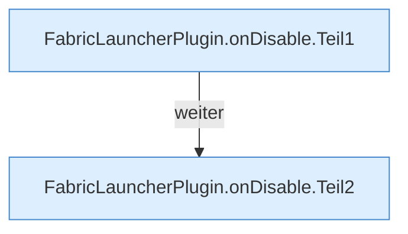

[[00 Start]] › [[Plugin-Kern]] › [[Lebenszyklus]] › [[FabricLauncherPlugin.onDisable]]

# FabricLauncherPlugin.onDisable

`FabricLauncherPlugin.onDisable()` [src/main/java/de/aichele/childlauncher/FabricLauncherPlugin.java:226–238](https://github.com/Sciddie/minecraft-serverhoster-plugin/blob/95b02b953b0b4c23673e900e021a7c3c844aa37d/src/main/java/de/aichele/childlauncher/FabricLauncherPlugin.java#L226-L238)



```knoten
FabricLauncherPlugin.onDisable.Teil1
  Ein weiterer Abschnitt derselben Übersicht. Im [[Glossar#Quelltext|Quelltext]] heißt das `Teil1`.
FabricLauncherPlugin.onDisable.Teil2
  Ein weiterer Abschnitt derselben Übersicht. Im [[Glossar#Quelltext|Quelltext]] heißt das `Teil2`.
```

> [!knoten]- Was die Blöcke tun
> - **FabricLauncherPlugin.onDisable.Teil1**: Ein weiterer Abschnitt derselben Übersicht. Im [[Glossar#Quelltext|Quelltext]] heißt das `Teil1`.
> - **FabricLauncherPlugin.onDisable.Teil2**: Ein weiterer Abschnitt derselben Übersicht. Im [[Glossar#Quelltext|Quelltext]] heißt das `Teil2`.

- Läuft, wenn der [[Glossar#Host|Host]] das [[Glossar#Plugin|Plugin]] ausschaltet. Der [[Glossar#Spielserver|Spielserver]] wird gestoppt, die [[Glossar#Bedienseite|Bedienseite]] geht zu, laufende Arbeiten werden abgebrochen.
