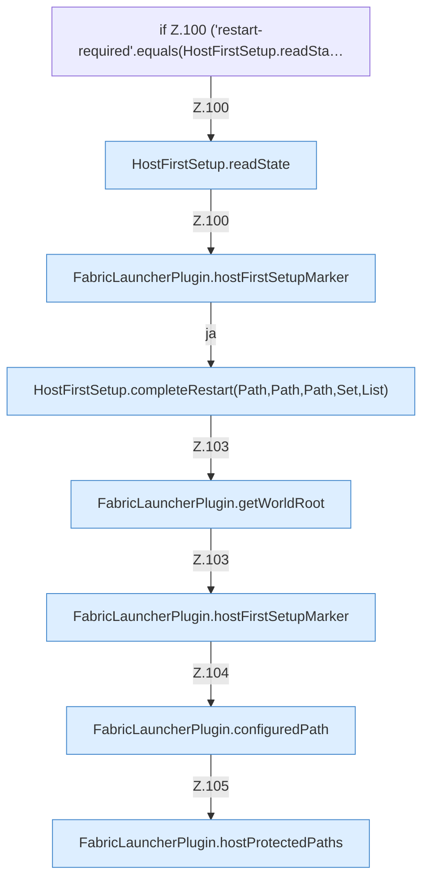

[[00 Start]] › [[Plugin-Kern]] › [[Lebenszyklus]] › [[FabricLauncherPlugin.onEnable]] › [[FabricLauncherPlugin.onEnable.Teil1.Z98.Z99.Z100]]

# FabricLauncherPlugin.onEnable.Teil1.Z98.Z99.Z100



```knoten
if Z.100 ('restart-required'.equals(HostFirstSetup.readSta…
  Zeile 100: prüft `('restart-required'.equals(HostFirstSetup.readSta…`.
HostFirstSetup.readState
  Liest `readState`. Ruft `readState`.
FabricLauncherPlugin.hostFirstSetupMarker
  Betrifft den Host `hostFirstSetupMarker`.
HostFirstSetup.completeRestart(Path,Path,Path,Set,List)
  Schließt ab `completeRestart`. Ruft `readState`, `requireRoot`, `lobbyNameSafe`.
FabricLauncherPlugin.getWorldRoot
  Liefert `getWorldRoot`.
FabricLauncherPlugin.configuredPath
  Liest den konfigurierten Wert `configuredPath`. Ruft `getWorldRoot`.
FabricLauncherPlugin.hostProtectedPaths
  Betrifft den Host `hostProtectedPaths`. Ruft `getWorldRoot`, `directory`.
```

- Fortsetzung von `FabricLauncherPlugin.onEnable.Teil1.Z98.Z99`, Quellreihenfolge.
