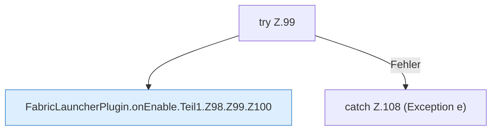

[[00 Start]] › [[Plugin-Kern]] › [[Lebenszyklus]] › [[FabricLauncherPlugin.onEnable]] › [[FabricLauncherPlugin.onEnable.Teil1.Z98.Z99]]

# FabricLauncherPlugin.onEnable.Teil1.Z98.Z99

- Fortsetzung von `FabricLauncherPlugin.onEnable.Teil1.Z98`, Quellreihenfolge.
