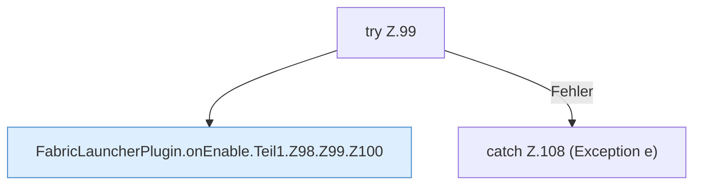

[[00 Start]] › [[Plugin-Kern]] › [[Lebenszyklus]] › [[FabricLauncherPlugin.onEnable]] › [[FabricLauncherPlugin.onEnable.Teil1.Z98.Z99]]

# FabricLauncherPlugin.onEnable.Teil1.Z98.Z99



```knoten
try Z.99
  Zeile 99: Versuch. Der Fehlerpfad geht in catch.
FabricLauncherPlugin.onEnable.Teil1.Z98.Z99.Z100
  Der Ablauf geht in [[Glossar#Zeile|Zeile]] 100 weiter. Eine Ebene tiefer steht er genauer. Fortsetzung des Ablaufs ab Zeile 100.
catch Z.108 (Exception e)
  Zeile 108: fängt (Exception e).
```

> [!knoten]- Was die Blöcke tun
> - **try Z.99**: Zeile 99: Versuch. Der Fehlerpfad geht in catch.
> - **FabricLauncherPlugin.onEnable.Teil1.Z98.Z99.Z100**: Der Ablauf geht in [[Glossar#Zeile|Zeile]] 100 weiter. Eine Ebene tiefer steht er genauer. Fortsetzung des Ablaufs ab Zeile 100.
> - **catch Z.108 (Exception e)**: Zeile 108: fängt (Exception e).

- Der Ablauf geht in [[Glossar#Zeile|Zeile]] 99 weiter. Eine Ebene tiefer steht er genauer.
- Fortsetzung von `FabricLauncherPlugin.onEnable.Teil1.Z98`.
