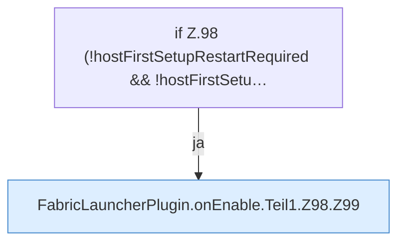

[[00 Start]] › [[Plugin-Kern]] › [[Lebenszyklus]] › [[FabricLauncherPlugin.onEnable]] › [[FabricLauncherPlugin.onEnable.Teil1.Z98]]

# FabricLauncherPlugin.onEnable.Teil1.Z98



```knoten
if Z.98 (!hostFirstSetupRestartRequired && !hostFirstSetu…
  Zeile 98: prüft `(!hostFirstSetupRestartRequired && !hostFirstSetu…`.
FabricLauncherPlugin.onEnable.Teil1.Z98.Z99
  Der Ablauf geht in [[Glossar#Zeile|Zeile]] 99 weiter. Eine Ebene tiefer steht er genauer. Fortsetzung des Ablaufs ab Zeile 99.
```

> [!knoten]- Was die Blöcke tun
> - **if Z.98 (!hostFirstSetupRestartRequired && !hostFirstSetu…**: Zeile 98: prüft `(!hostFirstSetupRestartRequired && !hostFirstSetu…`.
> - **FabricLauncherPlugin.onEnable.Teil1.Z98.Z99**: Der Ablauf geht in [[Glossar#Zeile|Zeile]] 99 weiter. Eine Ebene tiefer steht er genauer. Fortsetzung des Ablaufs ab Zeile 99.

- Der Ablauf geht in [[Glossar#Zeile|Zeile]] 98 weiter. Eine Ebene tiefer steht er genauer.
- Fortsetzung von `FabricLauncherPlugin.onEnable.Teil1`.
