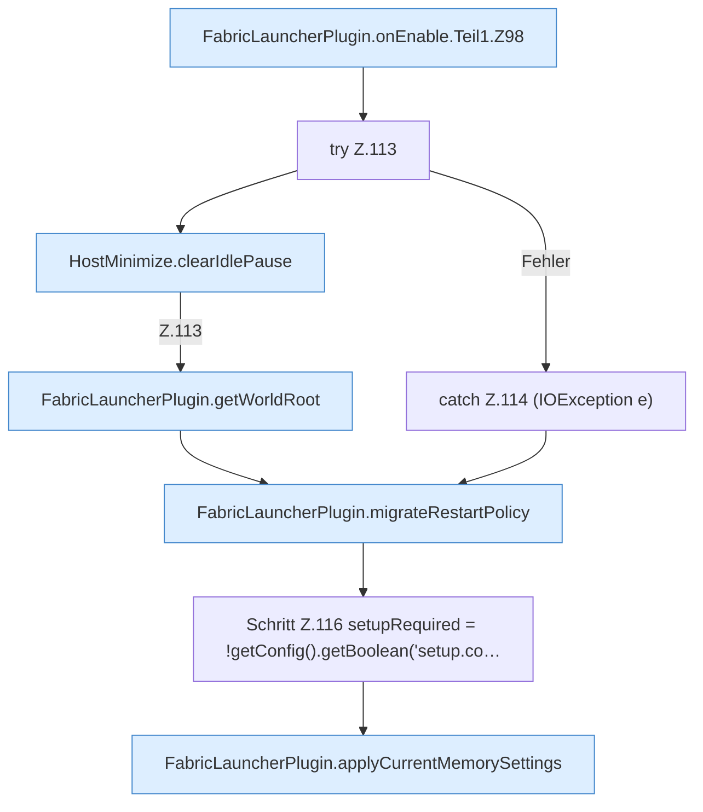

[[00 Start]] › [[Plugin-Kern]] › [[Lebenszyklus]] › [[FabricLauncherPlugin.onEnable]] › [[FabricLauncherPlugin.onEnable.Teil1]]

# FabricLauncherPlugin.onEnable.Teil1

- Fortsetzung von `FabricLauncherPlugin.onEnable`, Quellreihenfolge.
