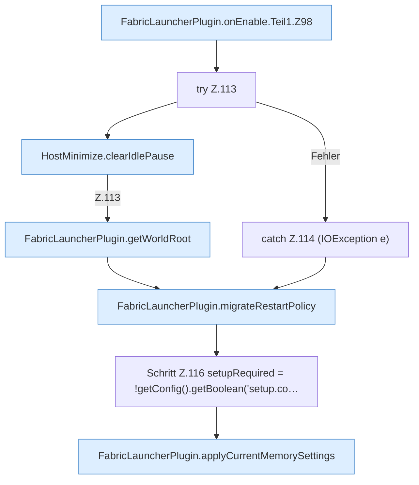

[[00 Start]] › [[Plugin-Kern]] › [[Lebenszyklus]] › [[FabricLauncherPlugin.onEnable]] › [[FabricLauncherPlugin.onEnable.Teil1]]

# FabricLauncherPlugin.onEnable.Teil1



```knoten
FabricLauncherPlugin.onEnable.Teil1.Z98
  Der Ablauf geht in [[Glossar#Zeile|Zeile]] 98 weiter. Eine Ebene tiefer steht er genauer. Fortsetzung des Ablaufs ab Zeile 98.
try Z.113
  Zeile 113: Versuch. Der Fehlerpfad geht in catch.
HostMinimize.clearIdlePause
  Das Verkleinern des [[Glossar#Host|Host]] löscht den gemerkten Stand von hier einen Schritt. Eine Ebene tiefer steht er genauer. Leert `clearIdlePause`. Ruft `lobbyNameSafe`.
FabricLauncherPlugin.getWorldRoot
  Das [[Glossar#Plugin|Plugin]] liefert die [[Glossar#Spielwelt|Spielwelt]] den Anfang. Liefert `getWorldRoot`.
catch Z.114 (IOException e)
  Zeile 114: fängt (IOException e).
FabricLauncherPlugin.migrateRestartPolicy
  Übernimmt eine ältere Schreibweise der [[Glossar#Neustart|Neustart]]-Regel in die heutige. Übernimmt den alten Wert von `migrateRestartPolicy`. Ruft `migrateLegacyUnlimited`, `migrateLegacyRestartPolicy`, `saveConfigWritable`.
Schritt Z.116 setupRequired = !getConfig().getBoolean('setup.co…
  Zeile 116: liest die Config. `setupRequired = !getConfig().getBoolean('setup.co…`
FabricLauncherPlugin.applyCurrentMemorySettings
  Das [[Glossar#Plugin|Plugin]] wendet an den aktuellen Stand den [[Glossar#Arbeitsspeicher|Arbeitsspeicher]] die [[Glossar#Einstellungen|Einstellungen]]. Wendet an `applyCurrentMemorySettings`. Ruft `saveConfigWritable`.
```

> [!knoten]- Was die Blöcke tun
> - **FabricLauncherPlugin.onEnable.Teil1.Z98**: Der Ablauf geht in [[Glossar#Zeile|Zeile]] 98 weiter. Eine Ebene tiefer steht er genauer. Fortsetzung des Ablaufs ab Zeile 98.
> - **try Z.113**: Zeile 113: Versuch. Der Fehlerpfad geht in catch.
> - **HostMinimize.clearIdlePause**: Das Verkleinern des [[Glossar#Host|Host]] löscht den gemerkten Stand von hier einen Schritt. Eine Ebene tiefer steht er genauer. Leert `clearIdlePause`. Ruft `lobbyNameSafe`.
> - **FabricLauncherPlugin.getWorldRoot**: Das [[Glossar#Plugin|Plugin]] liefert die [[Glossar#Spielwelt|Spielwelt]] den Anfang. Liefert `getWorldRoot`.
> - **catch Z.114 (IOException e)**: Zeile 114: fängt (IOException e).
> - **FabricLauncherPlugin.migrateRestartPolicy**: Übernimmt eine ältere Schreibweise der [[Glossar#Neustart|Neustart]]-Regel in die heutige. Übernimmt den alten Wert von `migrateRestartPolicy`. Ruft `migrateLegacyUnlimited`, `migrateLegacyRestartPolicy`, `saveConfigWritable`.
> - **Schritt Z.116 setupRequired = !getConfig().getBoolean('setup.co…**: Zeile 116: liest die Config. `setupRequired = !getConfig().getBoolean('setup.co…`
> - **FabricLauncherPlugin.applyCurrentMemorySettings**: Das [[Glossar#Plugin|Plugin]] wendet an den aktuellen Stand den [[Glossar#Arbeitsspeicher|Arbeitsspeicher]] die [[Glossar#Einstellungen|Einstellungen]]. Wendet an `applyCurrentMemorySettings`. Ruft `saveConfigWritable`.

- Ein weiterer Abschnitt derselben Übersicht.
- Fortsetzung von `FabricLauncherPlugin.onEnable`.
