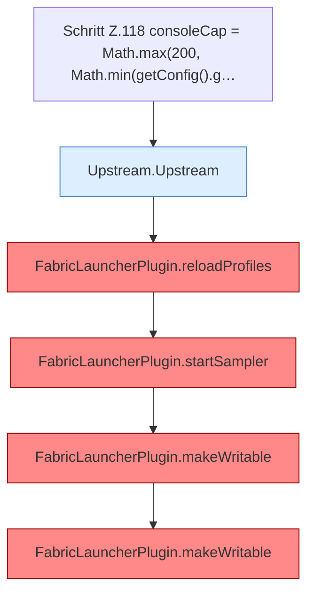

[[00 Start]] › [[Plugin-Kern]] › [[Lebenszyklus]] › [[FabricLauncherPlugin.onEnable]] › [[FabricLauncherPlugin.onEnable.Teil2]]

# FabricLauncherPlugin.onEnable.Teil2



```knoten
Schritt Z.118 consoleCap = Math.max(200, Math.min(getConfig().g…
  Zeile 118: liest die Config. `consoleCap = Math.max(200, Math.min(getConfig().g…`
Upstream.Upstream
  Holt Daten vom Netz `Upstream`.
FabricLauncherPlugin.reloadProfiles
  `Profiles.load`, danach nur `getFirst()`. Befund: angemeldet aber nicht umgesetzt (sicher).
FabricLauncherPlugin.startSampler
  Server-Thread, `runTaskTimer` 1 Tick / 1 Tick. Befund: Kommentar widerspricht Code (sicher).
FabricLauncherPlugin.makeWritable
  Setzt POSIX `rwxrwxrwx` für Ordner und `rw-rw-rw-` für Dateien. Befund: Logikrisiko (sicher).
```

- Fortsetzung von `FabricLauncherPlugin.onEnable`, Quellreihenfolge.
