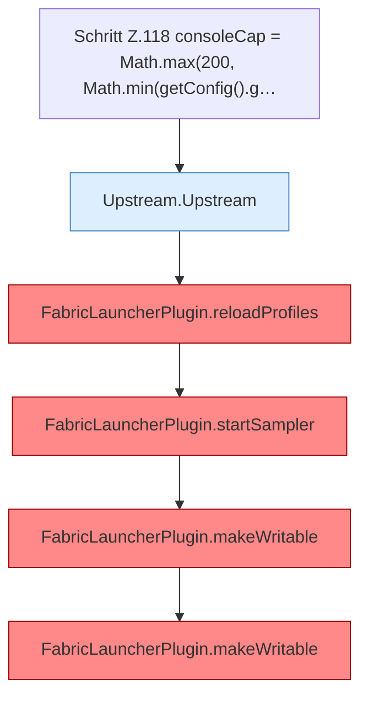

[[00 Start]] › [[Plugin-Kern]] › [[Lebenszyklus]] › [[FabricLauncherPlugin.onEnable]] › [[FabricLauncherPlugin.onEnable.Teil2]]

# FabricLauncherPlugin.onEnable.Teil2



```knoten
Schritt Z.118 consoleCap = Math.max(200, Math.min(getConfig().g…
  Zeile 118: liest die Config. `consoleCap = Math.max(200, Math.min(getConfig().g…`
Upstream.Upstream
  Dieser Teil macht hier einen einzelnen Schritt. Eine Ebene tiefer steht er genauer. Holt Daten vom Netz `Upstream`.
FabricLauncherPlugin.reloadProfiles
  Liest die Server aus den [[Glossar#Einstellungen|Einstellungen]] neu und behält nur den ersten. `Profiles.load`, danach nur `getFirst()`. [[Glossar#Befund|Befund]]: angemeldet aber nicht umgesetzt, sicher. FabricLauncherPlugin.java:266–272 getFirst verwirft servers.*
FabricLauncherPlugin.startSampler
  Lässt regelmäßig aufschreiben, wie der [[Glossar#Spielserver|Spielserver]] gerade läuft. Der Abstand ist ein [[Glossar#Spielschritt|Spielschritt]] des [[Glossar#Host|Host]]. Server-[[Glossar#Thread|Thread]], `runTaskTimer` 1 Tick / 1 Tick. [[Glossar#Befund|Befund]]: Kommentar widerspricht Code, sicher. Feldkommentar Z.66 once per second, runTaskTimer Z.1815 Periode 1 Tick, Schreiben alle 20 Ticks Z.1806
FabricLauncherPlugin.makeWritable
  Setzt die [[Glossar#Dateirechte|Dateirechte]] eines Ordners oder einer Datei sehr offen, damit der [[Glossar#Spielserver|Spielserver]] dort schreiben kann. Setzt POSIX `rwxrwxrwx` für Ordner und `rw-rw-rw-` für Dateien. [[Glossar#Befund|Befund]]: Logikrisiko, sicher. FabricLauncherPlugin.java:241–242 rwxrwxrwx und rw-rw-rw-. Kommentar Z.240 sagt rw für group/other
```

> [!knoten]- Was die Blöcke tun
> - **Schritt Z.118 consoleCap = Math.max(200, Math.min(getConfig().g…**: Zeile 118: liest die Config. `consoleCap = Math.max(200, Math.min(getConfig().g…`
> - **Upstream.Upstream**: Dieser Teil macht hier einen einzelnen Schritt. Eine Ebene tiefer steht er genauer. Holt Daten vom Netz `Upstream`.
> - **FabricLauncherPlugin.reloadProfiles**: Liest die Server aus den [[Glossar#Einstellungen|Einstellungen]] neu und behält nur den ersten. `Profiles.load`, danach nur `getFirst()`. [[Glossar#Befund|Befund]]: angemeldet aber nicht umgesetzt, sicher. FabricLauncherPlugin.java:266–272 getFirst verwirft servers.*
> - **FabricLauncherPlugin.startSampler**: Lässt regelmäßig aufschreiben, wie der [[Glossar#Spielserver|Spielserver]] gerade läuft. Der Abstand ist ein [[Glossar#Spielschritt|Spielschritt]] des [[Glossar#Host|Host]]. Server-[[Glossar#Thread|Thread]], `runTaskTimer` 1 Tick / 1 Tick. [[Glossar#Befund|Befund]]: Kommentar widerspricht Code, sicher. Feldkommentar Z.66 once per second, runTaskTimer Z.1815 Periode 1 Tick, Schreiben alle 20 Ticks Z.1806
> - **FabricLauncherPlugin.makeWritable**: Setzt die [[Glossar#Dateirechte|Dateirechte]] eines Ordners oder einer Datei sehr offen, damit der [[Glossar#Spielserver|Spielserver]] dort schreiben kann. Setzt POSIX `rwxrwxrwx` für Ordner und `rw-rw-rw-` für Dateien. [[Glossar#Befund|Befund]]: Logikrisiko, sicher. FabricLauncherPlugin.java:241–242 rwxrwxrwx und rw-rw-rw-. Kommentar Z.240 sagt rw für group/other

- Ein weiterer Abschnitt derselben Übersicht.
- Fortsetzung von `FabricLauncherPlugin.onEnable`.
