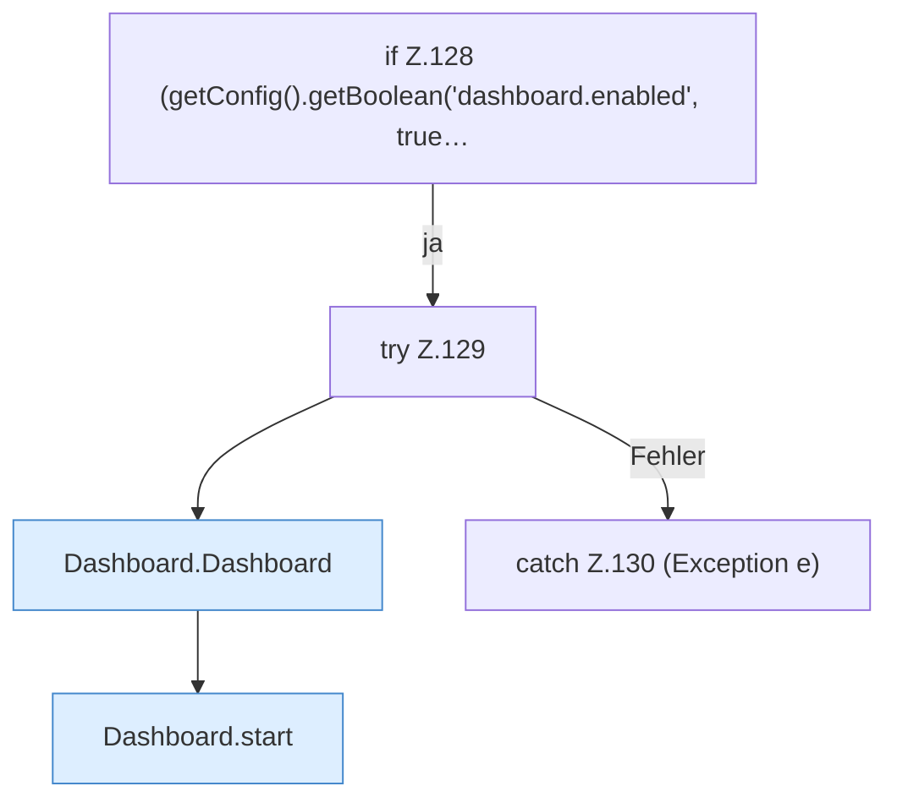

[[00 Start]] › [[Plugin-Kern]] › [[Lebenszyklus]] › [[FabricLauncherPlugin.onEnable]] › [[FabricLauncherPlugin.onEnable.Teil3.Z128]]

# FabricLauncherPlugin.onEnable.Teil3.Z128



```knoten
if Z.128 (getConfig().getBoolean('dashboard.enabled', true…
  Zeile 128: prüft `(getConfig().getBoolean('dashboard.enabled', true…`.
try Z.129
  Zeile 129: Versuch. Der Fehlerpfad geht in catch.
Dashboard.Dashboard
  Richtet die [[Glossar#Web-Schnittstelle|Web-Schnittstelle]] ein, wenn sie erzeugt wird. `Dashboard` in `Dashboard.java`.
Dashboard.start
  Öffnet die Tür der [[Glossar#Web-Schnittstelle|Web-Schnittstelle]]. Startet `start`. Ruft `read`, `passwordFile`, `setupRequired`.
catch Z.130 (Exception e)
  Zeile 130: fängt (Exception e).
```

> [!knoten]- Was die Blöcke tun
> - **if Z.128 (getConfig().getBoolean('dashboard.enabled', true…**: Zeile 128: prüft `(getConfig().getBoolean('dashboard.enabled', true…`.
> - **try Z.129**: Zeile 129: Versuch. Der Fehlerpfad geht in catch.
> - **Dashboard.Dashboard**: Richtet die [[Glossar#Web-Schnittstelle|Web-Schnittstelle]] ein, wenn sie erzeugt wird. `Dashboard` in `Dashboard.java`.
> - **Dashboard.start**: Öffnet die Tür der [[Glossar#Web-Schnittstelle|Web-Schnittstelle]]. Startet `start`. Ruft `read`, `passwordFile`, `setupRequired`.
> - **catch Z.130 (Exception e)**: Zeile 130: fängt (Exception e).

- Der Ablauf geht in [[Glossar#Zeile|Zeile]] 128 weiter. Eine Ebene tiefer steht er genauer.
- Fortsetzung von `FabricLauncherPlugin.onEnable.Teil3`.
