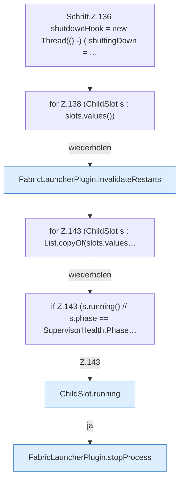

[[00 Start]] › [[Plugin-Kern]] › [[Lebenszyklus]] › [[FabricLauncherPlugin.onEnable]] › [[FabricLauncherPlugin.onEnable.Teil3.Z136]]

# FabricLauncherPlugin.onEnable.Teil3.Z136



```knoten
Schritt Z.136 shutdownHook = new Thread(() -) ( shuttingDown = …
  Zeile 136: `shutdownHook = new Thread(() -) ( shuttingDown = …`
for Z.138 (ChildSlot s : slots.values())
  Zeile 138: Schleife `(ChildSlot s : slots.values())`.
FabricLauncherPlugin.invalidateRestarts
  Vergisst geplante [[Glossar#Neustart|Neustarts]], damit ein absichtlicher [[Glossar#Stopp|Stopp]] nicht gleich wieder startet. Verwirft `invalidateRestarts`.
for Z.143 (ChildSlot s : List.copyOf(slots.values…
  Zeile 143: Schleife `(ChildSlot s : List.copyOf(slots.values…`.
if Z.143 (s.running() // s.phase == SupervisorHealth.Phase…
  Zeile 143: prüft `(s.running() // s.phase == SupervisorHealth.Phase…`.
ChildSlot.running
  Dieser Teil prüft, ob läuft, das. Sagt, ob der [[Glossar#Prozess|Prozess]] läuft `running`.
FabricLauncherPlugin.stopProcess
  Fährt den [[Glossar#Spielserver|Spielserver]] herunter: erst die Bitte, dann Warten, dann ein hartes Beenden. Stoppt `stopProcess`. Ruft `add`, `boundedSeconds`, `warnOnce`.
```

> [!knoten]- Was die Blöcke tun
> - **Schritt Z.136 shutdownHook = new Thread(() -) ( shuttingDown = …**: Zeile 136: `shutdownHook = new Thread(() -) ( shuttingDown = …`
> - **for Z.138 (ChildSlot s : slots.values())**: Zeile 138: Schleife `(ChildSlot s : slots.values())`.
> - **FabricLauncherPlugin.invalidateRestarts**: Vergisst geplante [[Glossar#Neustart|Neustarts]], damit ein absichtlicher [[Glossar#Stopp|Stopp]] nicht gleich wieder startet. Verwirft `invalidateRestarts`.
> - **for Z.143 (ChildSlot s : List.copyOf(slots.values…**: Zeile 143: Schleife `(ChildSlot s : List.copyOf(slots.values…`.
> - **if Z.143 (s.running() // s.phase == SupervisorHealth.Phase…**: Zeile 143: prüft `(s.running() // s.phase == SupervisorHealth.Phase…`.
> - **ChildSlot.running**: Dieser Teil prüft, ob läuft, das. Sagt, ob der [[Glossar#Prozess|Prozess]] läuft `running`.
> - **FabricLauncherPlugin.stopProcess**: Fährt den [[Glossar#Spielserver|Spielserver]] herunter: erst die Bitte, dann Warten, dann ein hartes Beenden. Stoppt `stopProcess`. Ruft `add`, `boundedSeconds`, `warnOnce`.

- Der Ablauf geht in [[Glossar#Zeile|Zeile]] 136 weiter. Eine Ebene tiefer steht er genauer.
- Fortsetzung von `FabricLauncherPlugin.onEnable.Teil3`.
