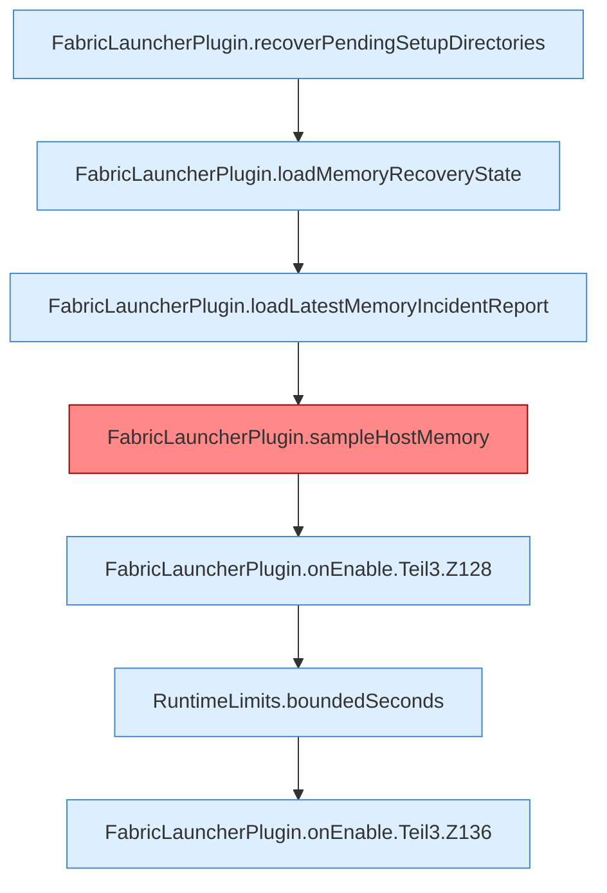

[[00 Start]] › [[Plugin-Kern]] › [[Lebenszyklus]] › [[FabricLauncherPlugin.onEnable]] › [[FabricLauncherPlugin.onEnable.Teil3]]

# FabricLauncherPlugin.onEnable.Teil3



```knoten
FabricLauncherPlugin.recoverPendingSetupDirectories
  Das [[Glossar#Plugin|Plugin]] rückt wieder gerade die [[Glossar#Einrichtung|Einrichtung]]. Hebt hängende Zustände auf `recoverPendingSetupDirectories`. Ruft `recover`, `getWorldRoot`, `cleanupLegacyDirectory`.
FabricLauncherPlugin.loadMemoryRecoveryState
  Das [[Glossar#Plugin|Plugin]] lädt den [[Glossar#Arbeitsspeicher|Arbeitsspeicher]] die Wiederherstellung den Zustand. Lädt `loadMemoryRecoveryState`. Ruft `memoryRecoveryFile`.
FabricLauncherPlugin.loadLatestMemoryIncidentReport
  Das [[Glossar#Plugin|Plugin]] lädt den letzten Stand den [[Glossar#Arbeitsspeicher|Arbeitsspeicher]] den [[Glossar#Vorfall|Vorfall]] den Bericht. Lädt `loadLatestMemoryIncidentReport`.
FabricLauncherPlugin.sampleHostMemory
  Misst einmal den [[Glossar#Arbeitsspeicher|Arbeitsspeicher]] des [[Glossar#Host|Host]] und entscheidet, ob der [[Glossar#Spielserver|Spielserver]] wegen Mangels aus muss. Ein Sample auf `ServerhosterPlugin-Memory`. [[Glossar#Befund|Befund]]: [[Glossar#Altlast|Altlast]], sicher. Z.1030–1031 liest memoryProtection.autoShutdown als Fallback
FabricLauncherPlugin.onEnable.Teil3.Z128
  Der Ablauf geht in [[Glossar#Zeile|Zeile]] 128 weiter. Eine Ebene tiefer steht er genauer. Fortsetzung des Ablaufs ab Zeile 128.
RuntimeLimits.boundedSeconds
  Dieser Teil macht hier einen einzelnen Schritt. Eine Ebene tiefer steht er genauer. Begrenzt `boundedSeconds`.
FabricLauncherPlugin.onEnable.Teil3.Z136
  Der Ablauf geht in [[Glossar#Zeile|Zeile]] 136 weiter. Eine Ebene tiefer steht er genauer. Fortsetzung des Ablaufs ab Zeile 136.
```

> [!knoten]- Was die Blöcke tun
> - **FabricLauncherPlugin.recoverPendingSetupDirectories**: Das [[Glossar#Plugin|Plugin]] rückt wieder gerade die [[Glossar#Einrichtung|Einrichtung]]. Hebt hängende Zustände auf `recoverPendingSetupDirectories`. Ruft `recover`, `getWorldRoot`, `cleanupLegacyDirectory`.
> - **FabricLauncherPlugin.loadMemoryRecoveryState**: Das [[Glossar#Plugin|Plugin]] lädt den [[Glossar#Arbeitsspeicher|Arbeitsspeicher]] die Wiederherstellung den Zustand. Lädt `loadMemoryRecoveryState`. Ruft `memoryRecoveryFile`.
> - **FabricLauncherPlugin.loadLatestMemoryIncidentReport**: Das [[Glossar#Plugin|Plugin]] lädt den letzten Stand den [[Glossar#Arbeitsspeicher|Arbeitsspeicher]] den [[Glossar#Vorfall|Vorfall]] den Bericht. Lädt `loadLatestMemoryIncidentReport`.
> - **FabricLauncherPlugin.sampleHostMemory**: Misst einmal den [[Glossar#Arbeitsspeicher|Arbeitsspeicher]] des [[Glossar#Host|Host]] und entscheidet, ob der [[Glossar#Spielserver|Spielserver]] wegen Mangels aus muss. Ein Sample auf `ServerhosterPlugin-Memory`. [[Glossar#Befund|Befund]]: [[Glossar#Altlast|Altlast]], sicher. Z.1030–1031 liest memoryProtection.autoShutdown als Fallback
> - **FabricLauncherPlugin.onEnable.Teil3.Z128**: Der Ablauf geht in [[Glossar#Zeile|Zeile]] 128 weiter. Eine Ebene tiefer steht er genauer. Fortsetzung des Ablaufs ab Zeile 128.
> - **RuntimeLimits.boundedSeconds**: Dieser Teil macht hier einen einzelnen Schritt. Eine Ebene tiefer steht er genauer. Begrenzt `boundedSeconds`.
> - **FabricLauncherPlugin.onEnable.Teil3.Z136**: Der Ablauf geht in [[Glossar#Zeile|Zeile]] 136 weiter. Eine Ebene tiefer steht er genauer. Fortsetzung des Ablaufs ab Zeile 136.

- Ein weiterer Abschnitt derselben Übersicht.
- Fortsetzung von `FabricLauncherPlugin.onEnable`.
