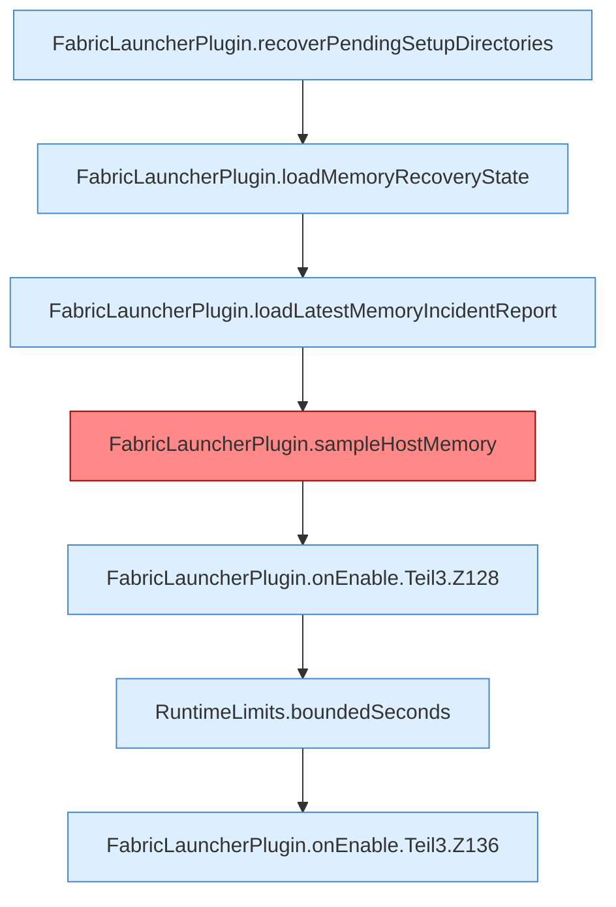

[[00 Start]] › [[Plugin-Kern]] › [[Lebenszyklus]] › [[FabricLauncherPlugin.onEnable]] › [[FabricLauncherPlugin.onEnable.Teil3]]

# FabricLauncherPlugin.onEnable.Teil3



```knoten
FabricLauncherPlugin.recoverPendingSetupDirectories
  Hebt hängende Zustände auf `recoverPendingSetupDirectories`. Ruft `recover`, `getWorldRoot`, `cleanupLegacyDirectory`.
FabricLauncherPlugin.loadMemoryRecoveryState
  Lädt `loadMemoryRecoveryState`. Ruft `memoryRecoveryFile`.
FabricLauncherPlugin.loadLatestMemoryIncidentReport
  Lädt `loadLatestMemoryIncidentReport`.
FabricLauncherPlugin.sampleHostMemory
  Ein Sample auf `ServerhosterPlugin-Memory`. Befund: Altlast (sicher).
FabricLauncherPlugin.onEnable.Teil3.Z128
  Fortsetzung des Ablaufs ab Zeile 128.
RuntimeLimits.boundedSeconds
  Begrenzt `boundedSeconds`.
FabricLauncherPlugin.onEnable.Teil3.Z136
  Fortsetzung des Ablaufs ab Zeile 136.
```

- Fortsetzung von `FabricLauncherPlugin.onEnable`, Quellreihenfolge.
