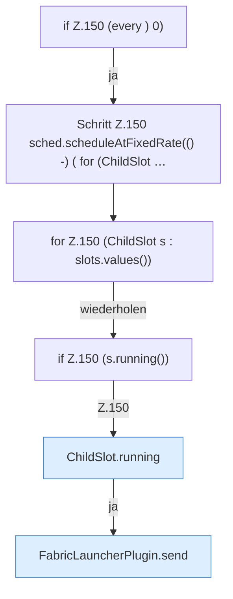

[[00 Start]] › [[Plugin-Kern]] › [[Lebenszyklus]] › [[FabricLauncherPlugin.onEnable]] › [[FabricLauncherPlugin.onEnable.Teil4.Z150]]

# FabricLauncherPlugin.onEnable.Teil4.Z150



```knoten
if Z.150 (every ) 0)
  Zeile 150: prüft `(every ) 0)`.
Schritt Z.150 sched.scheduleAtFixedRate(() -) ( for (ChildSlot …
  Zeile 150: startet einen festen Timer. `sched.scheduleAtFixedRate(() -) ( for (ChildSlot …`
for Z.150 (ChildSlot s : slots.values())
  Zeile 150: Schleife `(ChildSlot s : slots.values())`.
if Z.150 (s.running())
  Zeile 150: prüft `(s.running())`.
ChildSlot.running
  Dieser Teil prüft, ob läuft, das. Sagt, ob der [[Glossar#Prozess|Prozess]] läuft `running`.
FabricLauncherPlugin.send
  Schickt Text an den laufenden [[Glossar#Spielserver|Spielserver]]. Sendet `send`. Ruft `running`.
```

> [!knoten]- Was die Blöcke tun
> - **if Z.150 (every ) 0)**: Zeile 150: prüft `(every ) 0)`.
> - **Schritt Z.150 sched.scheduleAtFixedRate(() -) ( for (ChildSlot …**: Zeile 150: startet einen festen Timer. `sched.scheduleAtFixedRate(() -) ( for (ChildSlot …`
> - **for Z.150 (ChildSlot s : slots.values())**: Zeile 150: Schleife `(ChildSlot s : slots.values())`.
> - **if Z.150 (s.running())**: Zeile 150: prüft `(s.running())`.
> - **ChildSlot.running**: Dieser Teil prüft, ob läuft, das. Sagt, ob der [[Glossar#Prozess|Prozess]] läuft `running`.
> - **FabricLauncherPlugin.send**: Schickt Text an den laufenden [[Glossar#Spielserver|Spielserver]]. Sendet `send`. Ruft `running`.

- Der Ablauf geht in [[Glossar#Zeile|Zeile]] 150 weiter. Eine Ebene tiefer steht er genauer.
- Fortsetzung von `FabricLauncherPlugin.onEnable.Teil4`.
