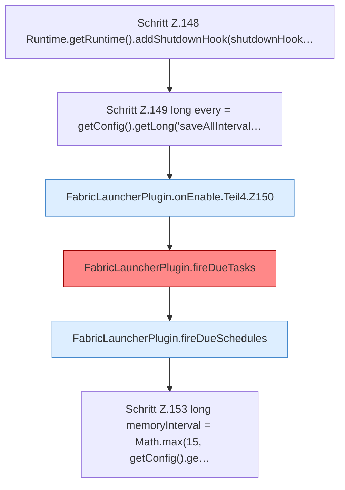

[[00 Start]] › [[Plugin-Kern]] › [[Lebenszyklus]] › [[FabricLauncherPlugin.onEnable]] › [[FabricLauncherPlugin.onEnable.Teil4]]

# FabricLauncherPlugin.onEnable.Teil4



```knoten
Schritt Z.148 Runtime.getRuntime().addShutdownHook(shutdownHook…
  Zeile 148: fragt die JVM-Laufzeit. `Runtime.getRuntime().addShutdownHook(shutdownHook…`
Schritt Z.149 long every = getConfig().getLong('saveAllInterval…
  Zeile 149: liest die Config. `long every = getConfig().getLong('saveAllInterval…`
FabricLauncherPlugin.onEnable.Teil4.Z150
  Fortsetzung des Ablaufs ab Zeile 150.
FabricLauncherPlugin.fireDueTasks
  Führt Fälliges aus in `fireDueTasks`. Ruft `tasks`, `matches`, `runTask`. Befund: Altlast (sicher).
FabricLauncherPlugin.fireDueSchedules
  Führt Fälliges aus in `fireDueSchedules`. Ruft `schedules`, `matches`, `cron`.
Schritt Z.153 long memoryInterval = Math.max(15, getConfig().ge…
  Zeile 153: liest die Config. `long memoryInterval = Math.max(15, getConfig().ge…`
```

- Fortsetzung von `FabricLauncherPlugin.onEnable`, Quellreihenfolge.
